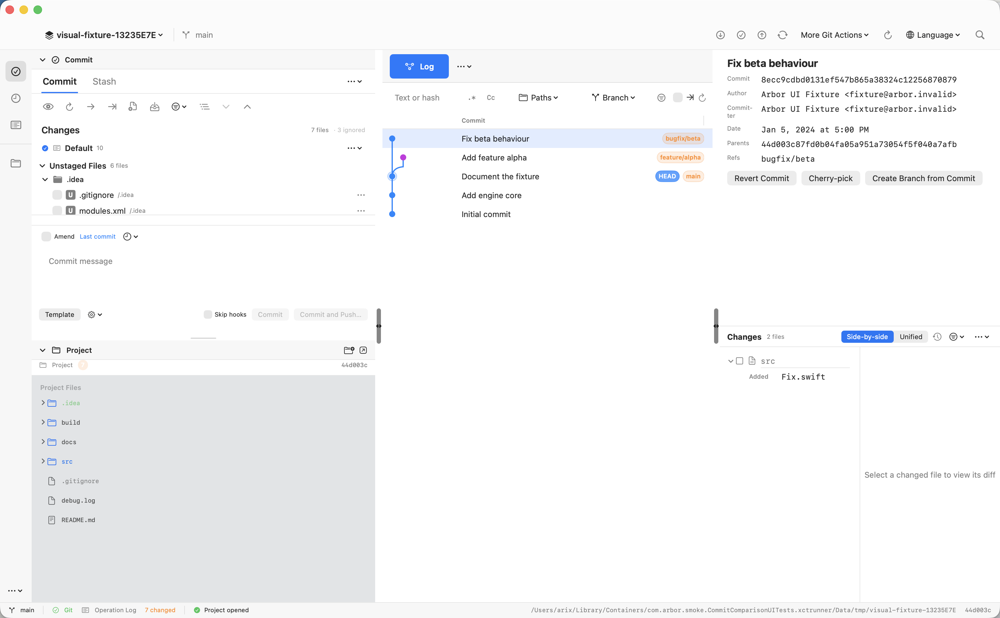

# Commit 主窗口 UI 对照：Rebased 与 Arbor

日期：2026-10-23。Arbor 源码基线：500cc06，构建版本 1.0.24；参照为本机 Rebased 1.1.13。

本轮交付为差距清单和实机截图。共记录 20 项界面差异，其中部分来自相同的布局问题；另有 1 项可见计数疑点。应用界面代码未改动。

后续已实施顶部栏、Commit/Project 结构及右侧比例的[第一轮调整](commit-ui-round1.md)，并完成剩余清单的[第二轮 UI 对齐](commit-ui-round2.md)。后续又完成字体、控件轮廓、图色和日期的[第三轮细节收敛](commit-ui-round3.md)。修改后的截图与测试边界见各轮报告。本文继续保留为修改前基线。

## 复核时先排除的四种误判

1. **把窗口记忆当成默认布局。** 两端都支持拖动分隔线。Arbor 的列宽和面板展开状态通过启动参数固定为源码默认值；Rebased 打开 Commit、Project、Log，恢复到约 628 pt 的左列占位和约 516 pt 的 Project 起始位置。这里比较的是选定的对照布局，不宣称 Rebased 的这些数值是出厂默认值。
2. **把数据差异当成 UI 差异。** Rebased 使用现有 visual-fixture，Arbor 打开其临时副本，包含相同的 .git 和 .idea 内容。两端均有 2 个已跟踪变更和 5 个未跟踪文件；Arbor 的“7 files”不能直接与 Rebased 的“Changes 2 files”相减来判断漏文件。临时副本的项目名带随机后缀，路径和根名称不纳入样式缺陷。
3. **把未选中与已选中截图混比。** 最终两端都打开 Log，选中 Fix beta behaviour（8ecc9cdbd0131ef547b865a38324c12256870879），右侧均有该提交的文件及元数据。本报告不沿用旧基线中“空详情区 vs 已加载详情区”的比较。
4. **把已有能力写成缺失。** Author/Date 列已经实现，默认关闭；文件树已有分类 SF Symbols 和 Git 状态着色。实际差距是默认可见性、图标细分、字体和状态标记呈现，不能写成“完全没有作者日期或文件图标”。

## 对照条件与截图

- 页面：主窗口 Commit/Stash 区域在左上，Project 在左下，Log 和提交详情在右侧。
- 环境：同一台 Mac，浅色外观、英文界面，窗口 1642×1015 pt；PNG 为 3284×2030 px，即 2× 截图。
- 数据：visual-fixture 的相同仓库快照；Arbor 使用临时副本，原仓库的 Git status 前后保持一致。
- 未统一的会话状态：Commit 的提交包含勾选与 Git index 暂存不是相同语义；Project 的目录展开和编辑器中已打开的其他页签保留。它们不能作为文件遗漏或额外功能的证据。
- 本轮没有对深色外观、中文排版、其他窗口尺寸和菜单展开状态作完整验收。

### Rebased

### Arbor

## 关键几何差距

以下坐标从窗口左上角计算。截图读数为近似值，约有 2 pt 误差；源码常量另行注明。

| 位置 | Rebased | Arbor | 影响 |
| --- | --- | --- | --- |
| 顶部窗口栏底边 | 约 43 pt | 约 82 pt | 主工作区整体下移约 39 pt |
| 首条 Log 提交的中心 y | 约 134 pt | 约 227 pt | 日志正文开始位置下移约 93 pt |
| 左侧整体占位 | 约 628 pt | 628 pt（52+564+12） | 已基本接近，不再登记为“左侧整列太窄” |
| Log 右侧详情区宽度 | 约 280 pt，另有右侧活动栏 | 约 460 pt | 日志表格可用宽度被压缩；详情内容的布局也需一起改 |
| Log 图形槽宽度 | 此仓库约 45 pt | 源码最小 120 pt | 图节点与提交标题之间留下大段空白 |
| Log 行距 | 此截图约 26 pt | 源码固定 31 pt | 同高度内能看到的提交更少 |

左侧 Project 的绝对起始位置也有差异，但它受到顶部栏高度、可拖拽面板高度共同影响；不能将旧报告中的高度数值直接当成当前固定缺陷。

## 差距清单

P1：先调整空间分配、主操作区域和默认信息；P2：在结构稳定后对齐视觉细节。这里的优先级是本次 UI 复刻的建议顺序。

| 编号 | 优先级 | 部位 | 当前差异与对齐标准 |
| --- | --- | --- | --- |
| U01 | P1 | 顶部窗口栏 | Rebased 将交通灯、项目、Update/Push、分支组织在一条紧凑栏内，搜索与设置靠右。Arbor 的交通灯上方区域与自绘工具栏形成两层，且右侧常驻较多 Git 操作、More Git Actions 和 Language。对齐目标：压缩到相近高度，按参照整理按钮位置与密度；保留多语言入口的可达性。 |
| U02 | P1 | Commit 标题层级 | Rebased 直接以 Commit/Stash 页签作标题；Arbor 上方另有一行可折叠的 Commit，再显示页签。对齐目标：消除重复标题，让列表工具栏和正文上移。 |
| U03 | P1 | Changes 列表模型 | Rebased 直接显示 Changes 组、包含勾选和文件；Arbor 显示 Changes 标题、Default changelist、Unstaged/Staged、目录、文件，多层级叠加。对齐目标：减少默认可见层级，让已跟踪变更优先出现，同时明确保留暂存状态。这里涉及交互语义，不能只改组名或复用原有勾选冒充等价。 |
| U04 | P1 | 未跟踪文件分组 | Rebased 将 5 个未跟踪文件放在独立、当前折叠的 Unversioned Files 组。Arbor 在数量不超过 1000 时混入 Unstaged Files；.idea 的行先占据列表首屏。对齐目标：同样提供独立组和清楚的组级包含状态，默认折叠策略另用首次启动状态验收。 |
| U05 | P1 | Ignored Files | Rebased 当前 Commit 列表不展示 ignored 组；Arbor 源码默认 showIgnored=true，并在标题中常驻 ignored 数量，下面还有 ignored 组。对齐目标：默认隐藏并保留设置入口。Ignored 计数是展示策略差异，不能归为 Git 状态数量计算错误。 |
| U06 | P1 | 变更树与提交编辑器分配 | 同一窗口内，Arbor 变更树首屏只露出 .idea 的两行，App.swift 和 Engine.swift 需要滚动寻找；提交编辑器占据较多高度。Rebased 的两个已跟踪变更一眼可见。对齐目标：在同一面板高度下让主要变更留在首屏，并保留列表和编辑器各自的滚动、拖拽能力。此项与 U02—U05 联动。 |
| U07 | P1 | 提交编辑器与按钮区 | Rebased 为 Amend 行、明确边框的输入框、左对齐 Commit/Commit and Push、右侧齿轮；有提交包含项时可显示 modified 数量。Arbor 输入框边界较弱，Template、齿轮、Skip hooks 和提交按钮同排，主要提交按钮靠右，Amend 行无相应计数。对齐目标：匹配控件位置、主次层级和选中变更反馈，额外选项通过已有设置收纳。空消息时红色提示的触发时机本轮未验证，不计作缺失。 |
| U08 | P1 | Project 树的结构 | Rebased 的 Project 标题下直接是仓库名称与路径根节点；Arbor 还有 Project 摘要行、数量/HEAD 信息和 Project Files 标题，正文从这些辅助行下面开始。对齐目标：用真实仓库根节点建立层级，把重复摘要移出主树视线。 |
| U09 | P1 | 右侧详情布局 | Rebased 上部为变更文件树，下部为紧凑提交详情；Arbor 上部是大块元数据和 Revert/Cherry-pick/Create Branch 按钮，下部为 Changes 与嵌入 Diff，占用更宽。对齐目标：先按参照重排详情内容与操作位置，再收窄面板；仅拖窄现有面板会让字段和按钮截断。 |
| U10 | P1 | Log 正文起点与图形槽 | Arbor 的顶部层级、Log 标题和列头使首条提交比参照下移约 93 pt，最小 120 pt 的图形槽还压缩了提交标题空间。对齐目标：缩短正文前的结构，按此仓库的实际 lane 数收敛图形槽；多分支图的可读性需要另行复核。 |
| U11 | P1 | Author/Date 默认展示 | Rebased 的同一日志行直接显示作者和日期。Arbor 已实现这些列，但默认关闭，截图里只有提交信息与引用标签。对齐目标：同尺寸下默认可见作者、日期，保证列宽和横向滚动仍可用。 |
| U12 | P2 | 面板底色与轮廓 | Rebased 使用浅灰外层、白色圆角 Commit/Project 面板和更淡的日志内容底色。Arbor 更接近平铺，Project 树有明显深灰底，各区域边界语言不同。对齐目标：统一外层、面板、正文的层级和圆角、留白；深色外观需单独验证。 |
| U13 | P2 | 页签样式 | Rebased 的 Commit 和 Log 是小尺寸、淡色描边的选中页签；Arbor 的 Commit 为粗体加下划线，Log 为较大的实心蓝按钮。对齐目标：统一页签尺寸、边框、选中态和与工具栏的间距，避免把页签绘制成主操作按钮。 |
| U14 | P2 | Log 筛选栏 | Rebased 依次提供 Text/Regex/Case、Branch、User、Date、Paths 及图/操作工具；Arbor 为 Paths、Branch 和合并的作者日期图标等，顺序和入口形态不同。对齐目标：按参照恢复信息顺序与可辨认入口；既有筛选能力保留。 |
| U15 | P2 | 日志行密度 | Arbor 固定 31 pt 行距，参照截图约 26 pt。对齐目标：收敛行高、字体基线和上下间距；长消息与中文/表情仍应限于本行，不能以缩高引入重叠。 |
| U16 | P2 | 提交图线条与节点 | Arbor 常规边线为 2 pt，颜色以蓝色主线加分叉为主；参照更细，分支配色、当前节点描边也不同。对齐目标：对照同一图形调整线宽、节点尺寸与颜色分配。参照普通节点同样有实心节点，不应把“全部改为空心”当作标准。 |
| U17 | P2 | 引用标签 | Rebased 以小标签图标配普通文字显示 branch/tag；Arbor 使用橙色胶囊，并额外显示醒目的 HEAD 胶囊。对齐目标：调整图标、文字、背景和标签对齐，保留 HEAD 与分支的识别能力。 |
| U18 | P2 | 文件字体、图标与状态 | Rebased 使用正常比例字体、更具体的文件类型图标和紧凑状态标记；Arbor 的 Project 文件名偏小、等宽，使用按大类分类的 SF Symbols，Changes 文件行还有 M/U 等方形徽章。对齐目标：统一字号、行距、类型识别和状态标记尺寸。这里是呈现细分差距，已有图标和状态颜色并非缺失。 |
| U19 | P2 | 活动栏与通知入口 | Rebased 左侧栏约 40 pt，Commit/Project 紧邻，通知在右侧窄栏；Arbor 左侧为 52 pt，加入 Log/Operations 等入口，反馈主要在底部。对齐目标：整理宽度、分组、选中背景与通知入口位置；保留 Arbor 已有功能的可达性，不照搬 IDE 专属 Terminal 等内容。 |
| U20 | P2 | 分隔线与拖拽手柄 | Rebased 面板间以细留白/边界分开；Arbor 12 pt 竖向分隔区中央绘制粗灰色手柄，横向还有胶囊拖动标记。对齐目标：减弱手柄视觉重量，匹配留白与边界，同时保留足够的拖拽命中区。 |

U03、U04、U07 与当前固定 staging-area 提交模式有关。参考端的提交包含勾选和 Arbor 的暂存勾选不能视为同一操作；后续实现应保留 Git index 语义，并把视觉布局与提交选择行为一起验收。

## 单独待查：同一提交的文件计数

**B01：Arbor 显示 Changes 2 files，参照显示 src 1 file，Git 也只有一个文件。**

两端均选中 Fix beta behaviour。以下只读查询返回 src/Fix.swift，1 file changed：

    git -C tmp/visual-fixture show --format=oneline --stat 8ecc9cd

Arbor 截图的文件树也只看见 Fix.swift，但标题计数为 2。这是需要复现和定位的可见正确性疑点。源码标题使用 rows.count；仅凭截图不能断言是重复记录、选择状态、异步加载或目录计数引起，本轮不指定根因、不修改实现。

## 源码核对位置

| 项目 | 主要位置 |
| --- | --- |
| 顶部工具栏、变更组、状态徽章 | [Panels+Core.swift](../Arbor/Panels/Panels+Core.swift) |
| Commit 列表、1000 文件阈值、ignored 默认值、提交编辑器 | [Panels+Commit.swift](../Arbor/Panels/Panels+Commit.swift) |
| 主窗口工具窗组合与 Project 标题 | [ContentView+ToolWindows.swift](../Arbor/MainWindow/ContentView+ToolWindows.swift) |
| 默认列宽、面板高度、Author/Date 列开关 | [ContentView.swift](../Arbor/ContentView.swift) |
| 日志行高、图形槽、线宽、引用标签 | [LogGraphView.swift](../Arbor/LogGraphView.swift) |
| 右侧元数据/文件树顺序 | [Log+ContentView.Commit.swift](../Arbor/Log/Log+ContentView.Commit.swift) |
| 文件树图标分类、字体与状态着色 | [ProjectFileTreeView.swift](../Arbor/ProjectFileTreeView.swift) |
| 文件计数 | [Log+ChangesBrowser.swift](../Arbor/Log/Log+ChangesBrowser.swift) |
| 分隔条与拖拽手柄 | [ResizableWorkspacePanels.swift](../Arbor/ResizableWorkspacePanels.swift) |
| 外观色与通用间距 | [Design.swift](../Arbor/Design.swift) |

## 建议的第一轮实施范围

先处理 U01、U02、U07、U08、U09、U10：压缩顶部与重复标题，整理提交区和 Project 根节点，恢复右侧“文件在上、详情在下”的组织方式，并释放日志正文空间。这组改动最能改变主窗口的整体观感。

随后处理 U03—U06、U11：让变更列表和日志默认信息接近参照，同时保持暂存、部分暂存、未跟踪文件与现有 changelist 能力正确。最后统一 U12—U20 的表面、字体、页签、图标和图形细节。

每轮用同一快照、同一窗口尺寸重拍；对已有滚动、拖拽、键盘选择和提交操作做针对性验收。原生 AppKit/SwiftUI 控件可以定制这些布局和样式，此处的差距无需以“原生 macOS 限制”为理由保留。

## 本轮证据与验证边界

- 当前源码构建成功，原有 Arbor 截图测试与 Rebased 截图测试均执行成功。
- 最终受控截图测试 CommitComparisonUITests.testMatchedCommitPage 通过，1 个测试、0 失败；结果位于 build/ui-compare-20261023/controlled/matched-v4.xcresult。
- 该测试固定窗口尺寸与 Arbor 的布局参数、打开参照端 Project/Log，并截取两个窗口；截图导出后逐张目视确认选中的是同一提交。测试通过只代表采集条件通过，不代表 UI 已对齐。
- 临时采集 target 与日志位于忽略的 build/ui-compare-20261023/controlled 中；应用源码和原有测试源码保持不变。
- 两张报告 PNG 均已核对为 3284×2030 px。原始未缩放截图保存在本文的 images/commit-ui-comparison 目录。
- 旧 [visual-baseline.md](visual-baseline.md) 用于历史参考；本报告修正了“作者日期列未实现”“树完全没有图标”以及不同选择状态可直接比较等口径，不重新宣称所有页面已完成复刻。
