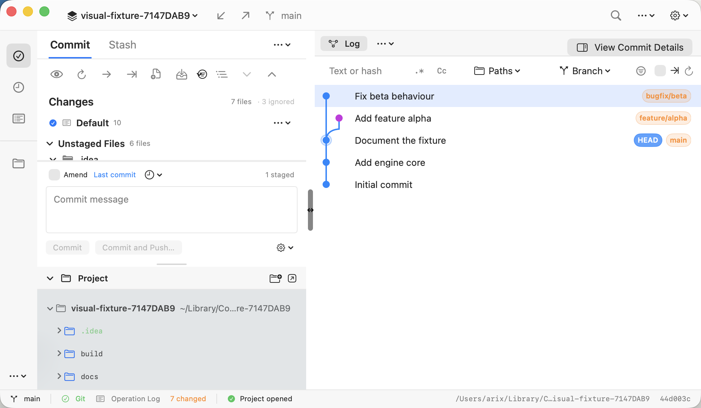
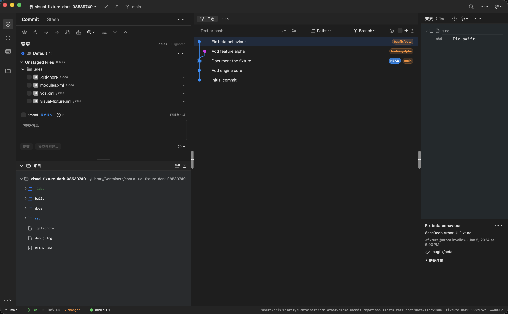

# Commit 主窗口：第一轮 UI 对齐

日期：2026-10-23。基于 500cc06 / Arbor 1.0.24 的工作区修改，参照 Rebased 1.1.13。[原始差距清单](commit-ui-comparison.md)保留为修改前基线。

## 交付前重点复核

先检查最容易误判或退化的五处：

1. **对照条件是否一致。** 英文浅色主图为 1642×1015 pt、3284×2030 px；同一仓库快照，选中同一提交 8ecc9cdbd0131ef547b865a38324c12256870879。Rebased 图沿用上一轮已核对的基线，本轮重新拍摄 Arbor。仓库副本的随机后缀和路径不作为视觉差距。
2. **收进菜单是否丢失操作或当前状态。** Commit Options 保留 Template、Before Commit Checks、Skip hooks；启用 Skip hooks 后，提交按钮旁显示状态提示。Commit Actions 保留 Revert、Cherry-pick、Create Branch 及托管平台入口。Fetch、Refresh、其他 Git 操作在顶部 More Git Actions 中，多语言入口在设置菜单中。
3. **窄窗口是否挤坏日志和详情。** 日志表格最小 540 pt、详情最小 280 pt；不足时切换独立详情页，不覆盖用户保存的分隔线位置。原生菜单可以伸出窗口边缘，验收要求其可见、可点击，不要求菜单完全落在窗口内部。
4. **暂存语义是否改变。** 暂存、取消暂存、部分暂存和提交启用条件保持原逻辑；新增计数明确写 staged。未把 Rebased 的提交包含勾选当作 Git index 勾选，也未调整 Changes / Untracked / Ignored 分组。
5. **短历史对齐是否损害复杂图。** 图形槽仍按 lane 数增长，保留 360 pt 上限和原有 lane 压缩逻辑。截图验证了此仓库的两条 lane；极端多分支历史没有做完整视觉验收。

## 本轮结果

| 项目 | 修改前 Arbor | 本轮 Arbor | Rebased 基线 |
| --- | --- | --- | --- |
| 顶部栏底边 | 约 82 pt，两层 | 43 pt，一行 | 约 43 pt |
| 首条 Log 提交中心 y | 约 227 pt | 134.5 pt，截图测试核对 | 约 134 pt |
| 左侧整体占位 | 628 pt | 628 pt | 约 628 pt |
| Project 标题起点 | 受重复标题及旧顶部栏影响 | 约 520 pt | 约 516 pt |
| 右侧详情宽度 | 约 460 pt | 280 pt | 约 280 pt，另有活动栏 |
| 此仓库的图形槽 | 最小 120 pt | 46 pt | 约 45 pt |
| Commit 编辑器高度约束 | 180–240 pt | 140–180 pt | 紧凑底部编辑器 |

截图读数约有 2 pt 误差；43、280、46 pt 等另有源码常量支持。窗口尺寸和 Log 首行位置由受控采集测试验证。

- **U01 顶部栏：** 项目、Update、Push、分支放在左侧同一行，搜索和菜单放在右侧。项目完整路径保留在提示中；恢复操作组件继续保留。
- **U02 重复标题：** 展开的 Commit 窗口直接以 Commit/Stash 页签作标题。隐藏工具窗移入页签右侧菜单，折叠后仍可展开；Operations 的独立标题保持原有组织。
- **U07 提交区：** Amend 行、带边框的消息框、左对齐的提交按钮、右侧设置菜单。提交编辑器更紧凑，列表可获得更多空间；附加提交动作和禁用条件保留。
- **U08 Project：** 去掉 Project 摘要、计数/HEAD 行及 Project Files 标题；Project 标题下直接显示可展开的真实仓库根节点、名称和路径。
- **U09 右侧：** 文件树在上、紧凑提交详情在下；完整哈希、Committer、Parents 和签名放入详情展开区。选择文件后，窄详情区自动上下排列文件树与 Diff，避免强塞左右两列。
- **U10 Log 起点：** 压缩 Log 页签行和筛选栏；只显示 Commit 一列时隐藏冗余列头，开启作者等其他列后仍保留列头及列操作。图形槽根据实际 lane 数收敛。

## 截图对照

### Rebased 基线

### Arbor 修改前

### Arbor 本轮

### 窄窗口

这张实际为 980×572 pt（1960×1144 px）。测试请求 540 pt 高，但当前窗口最小尺寸将其限制在 572 pt；本轮没有修改该窗口尺寸限制，也不把这张图标为 980×540。

### 中文深色

同为 1642×1015 pt。使用 XCTest 外观接口切换后实际拍摄，已目视确认是深色；测试结束恢复原外观。这里检查基本排版和新增中文文案，未做 Rebased 深色样式的逐项对照。

## 验证记录

- 最终 Debug 构建成功：build/ui-compare-20261023/controlled/build-round1-final.log。
- 英文主图和窄窗口采集、Log 首行位置、Template / Skip hooks 入口、提交操作菜单及 Create Branch 打开后取消：CommitComparisonUITests.testMatchedCommitPage 通过。最终主图来自 round1-final.xcresult 中该项通过的测试。
- 中文暂存计数和深色采集：round1-dark-v3.xcresult，1 项测试、0 失败；源码与英文最终图相同。最初试拍的外观参数未生效，没有将那张浅色图用作深色证据。
- Amend 与 Skip hooks 状态切换、窄窗口选中提交、两条原生分隔线拖拽及宽度恢复、详情菜单和 Create Branch：round1-checks-v2.xcresult，2 项测试、0 失败。
- Fetch 无 remote 时仍有可见说明、980 / 1200 / 1540 / 1642 pt 宽度下筛选栏留在面板内：round1-checks.xcresult 中这两项通过。该次另外两项旧断言已按新布局修订，并在上述 v2 结果中重跑通过。
- Git fixture 原始仓库的已跟踪变更与未跟踪文件保持一致；操作测试使用临时副本。没有执行提交、推送或改动真实仓库的 index。
- git diff --check 和字符串目录 JSON 校验通过。Rust 引擎未改动，本轮未重复运行引擎测试。

截图已逐张查看，测试通过与视觉对齐分别判断。临时采集 target、原始附件和日志保留在忽略的 build/ui-compare-20261023/controlled 目录中；这次不是全量功能回归。

## 尚未对齐

本轮完成主要布局，仍不是逐像素复刻：

- Changes 的 changelist / Staged / Unstaged 层级、未跟踪分组和 Ignored 默认展示仍按原实现（U03–U06）。列表首屏仍可能先出现 .idea 文件。
- Author / Date 默认仍关闭（U11）；开启后的列宽与横向滚动需要在下一轮默认信息对齐时继续验收。
- 页签、底色/圆角、字体、文件图标、引用标签、活动栏、分隔手柄等视觉差异仍在（U12–U20）。日志行距仍为 31 pt。
- 顶部交通灯位置和按钮图形仍有细节差距；Project 纵向位置约差 4 pt。
- B01 的文件计数疑点仍在：此提交的文件树显示一个文件，Changes 标题显示 2 files。本轮没有把布局调整当成该问题的修复。
- 中文界面仍有原有的英文动态标签；本轮新增的暂存计数、提交选项、提交操作及详情等文案补有中文，不代表完成了全量汉化。

## 改动位置

- [顶部工具栏](../Arbor/Panels/Panels+Core.swift)、[主窗口布局](../Arbor/MainWindow/ContentView+Layout.swift)
- [工具窗组合](../Arbor/MainWindow/ContentView+ToolWindows.swift)、[Commit 编辑器](../Arbor/Panels/Panels+Commit.swift)
- [Project 容器](../Arbor/MainWindow/MainWindow+Project.swift)、[Project 树](../Arbor/ProjectFileTreeView.swift)
- [Log 分栏](../Arbor/Log/Log+ContentView.Log.swift)、[详情顺序](../Arbor/Log/Log+ContentView.Commit.swift)、[紧凑元数据](../Arbor/CommitDetailView.swift)、[Changes/Diff](../Arbor/Log/Log+ChangesBrowser.swift)
- [Log 标题](../Arbor/Log/Log+ContentView.Columns.swift)、[筛选栏高度](../Arbor/Log/Log+ContentView.Filters.swift)、[图形槽/列头](../Arbor/LogGraphView.swift)
