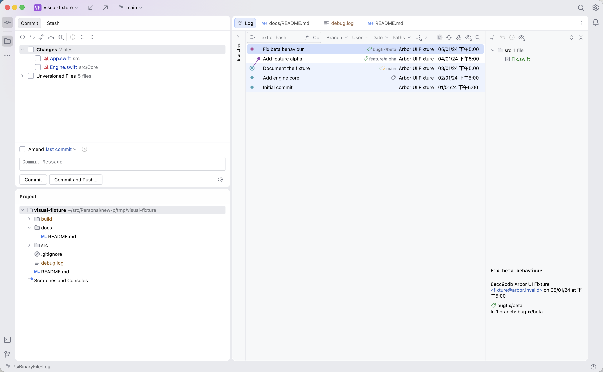
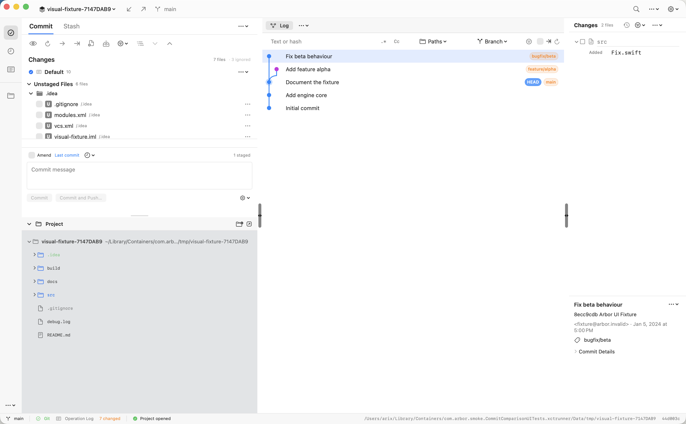
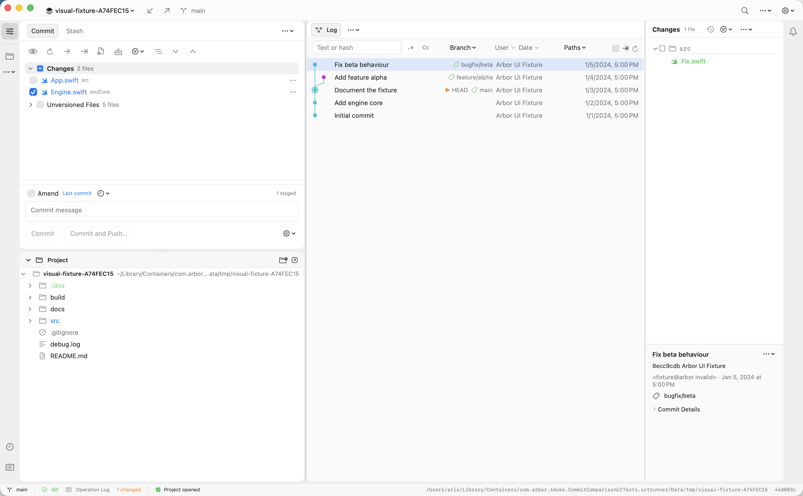
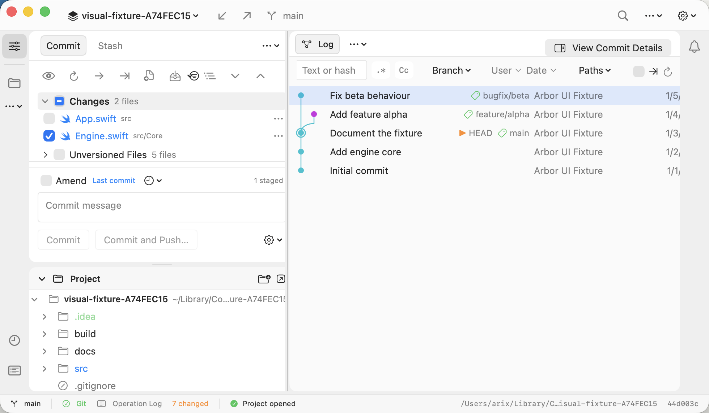
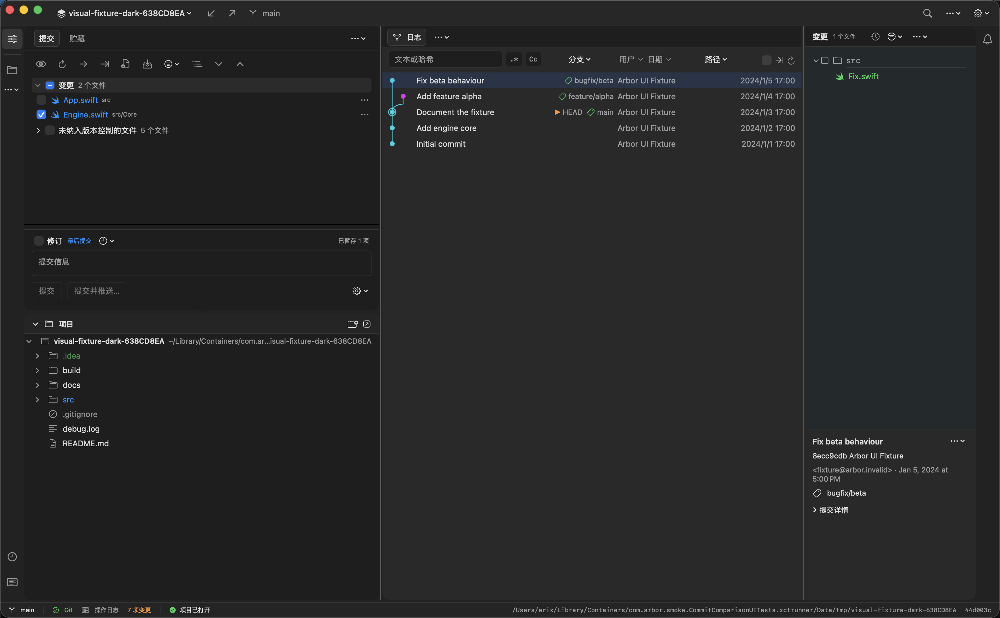

# Commit 主窗口 UI 对齐：第二轮

日期：2026-10-23。参照：本机 Rebased 1.1.13；Arbor 1.0.24，源码基线 500cc06，叠加第一轮与本轮未提交改动。

本轮实施原清单剩余的 14 项（U03–U06、U11–U20），并修复 B01 的提交文件计数。目标仍是原生 macOS 的 Rebased 布局与视觉对齐。勾选明确表示 Git index 暂存，不等同于 Rebased 的提交包含勾选。

后续的[第三轮细节收敛与测试记录](commit-ui-round3.md)已补齐字体、控件轮廓、图色、日期和最终对照图。本文继续保留第二轮时的验证范围。

## 交付前重点复核

最容易出错的五处，以及对应证据：

1. **合并列表后误改部分暂存语义。** 一个路径只出现一次；已暂存为勾选，部分暂存为横线并显示说明。勾选部分暂存文件会暂存剩余内容；右键仍能取消暂存、比较 index/HEAD/工作区、进入行级暂存。测试在临时副本中覆盖这些状态转换及组级操作。
2. **默认折叠隐藏了实际变更。** 只折叠 Unversioned Files；App.swift 与 Engine.swift 在主图和窄图首屏可见，组级计数分别为 2 和 5。默认 changelist 仍参与成员过滤，自定义列表保留标题及管理操作。
3. **窄窗口和滚动区域吞掉按钮。** 对 980 / 1200 / 1540 / 1642 pt 等宽度检查日志、筛选栏、详情切换；实际拖拽两条原生分隔线并验证宽度恢复。作者、日期编辑弹窗分别由对应按钮承载，应用和清除均通过。测试通过“编辑 → 粘贴”菜单输入文本、点击空白处关闭采集弹窗，避免 XCTest 模拟按键触发第三方输入法授权；粘贴结束恢复剪贴板。
4. **修正计数时丢掉特殊文件。** Rust 新回归先复现目录容器混入计数，再与 git diff-tree 的结果比较。仅排除纯目录记录，保留普通文件、符号链接、gitlink 和文件/目录类型变化；新增用例显式检查嵌套文件增删改与 gitlink，另跑既有历史及差异用例。
5. **浅色通过而深色或中文失效。** 分别实拍英文浅色、中文深色和窄窗口；深色使用 XCTest 外观接口切换，结束恢复。新增文件计数、筛选器、修订、贮藏、部分暂存和通知等中文文案。

## 已处理的差距

| 编号 | 优先级 | 本轮结果 |
| --- | --- | --- |
| U03 | P1 | 普通仓库显示 Changes → 文件；隐藏单个 Default changelist 的冗余标题，合并同一路径的 index/工作区条目。明确显示已暂存和部分暂存。自定义 changelist 的激活、重命名、移动及拖放入口保留。 |
| U04 | P1 | Unversioned Files 始终独立，首次呈现默认折叠；组级复选框可以暂存整组，文件暂存后归入 Changes。混合状态有横线反馈。 |
| U05 | P1 | Ignored Files 默认隐藏，Show Ignored 设置保留；已有项目明确保存的偏好继续生效。设置测试检查默认值、路径规范化和项目隔离。 |
| U06 | P1 | 已跟踪变更先出现，默认文件列表扁平展示名称与相对父路径。提交编辑器压至 126–140 pt，消息框 42 pt，保留列表滚动与原生纵向分隔线。 |
| U11 | P1 | Author / Date 默认显示；日期使用紧凑的本地化格式。整表仍可横向滚动。列标题默认隐藏以维持 Log 起点，可在 Log Columns → Show Column Headers 中开启并继续拖动列宽；原有列宽/排序菜单保留。 |
| U12 | P2 | 浅灰工作区外框，白色圆角 Commit / Project 卡片与淡色 Log 正文；Project 去除系统侧栏深灰底及行分隔线。颜色有对应深色值，圆角 10 pt。 |
| U13 | P2 | Commit / Stash / Log 统一为紧凑页签，13 pt 字体、28 pt 高度、轻底色与细描边；移除 Commit 下划线。提交按钮使用轻描边，适配当前 macOS 的控件外观。 |
| U14 | P2 | 顺序为 Text / Regex / Case → Branch → User → Date → Paths。作者和日期提供独立命名入口；原有路径、多分支、正则和大小写功能保留。 |
| U15 | P2 | 日志固定行距 31 → 26 pt；长英文、中文、emoji 和换行符主题保持单行，不跨入相邻行。 |
| U16 | P2 | 普通图线 2 → 1.3 pt，节点直径 8 pt、merge 节点 9 pt，HEAD 使用清晰外圈；调整 lane 调色顺序。沿用现有图拓扑、命中区域、展开/折叠和窗口化绘制。 |
| U17 | P2 | 分支/标签从橙色胶囊改为细标签图标与普通文字；HEAD 使用小箭头与文字。远程引用和标签仍可辨认，Compact References 设置保留。 |
| U18 | P2 | 文件名称使用 13 pt 比例字体，Project / Changes / 提交详情共享细分 SF Symbols；Swift、源码、配置、Markdown、日志、图片和 .gitignore 分别识别。状态通过图标/文字着色及暂存复选框表达。 |
| U19 | P2 | 左活动栏 52 → 40 pt，Commit 与 Project 相邻，More 在上，Log / Operations 在下；右侧增加 40 pt 通知栏，铃铛打开现有操作历史。 |
| U20 | P2 | 两条横向原生分隔线显示宽度 12 → 6 pt，拖拽命中区保留 12 pt；去除中间的大胶囊及双向箭头。Commit / Project 间保留 7 pt 拖拽区与淡色细线。 |

## 文件计数 B01

此前 Fix beta behaviour 的树里只有 src/Fix.swift，标题却显示 2 files。根因是 gix 的树差异同时返回 src 目录记录和 src/Fix.swift 文件记录，标题计算了两项，文件树则把目录当容器合并了。

修复位于 arbor-engine/src/tree.rs，过滤纯目录容器，不在 UI 中简单减一。新增的两层目录回归在修复前返回 src、src/Core、src/Core/Engine.swift 三项，系统 Git 仅返回文件一项；修复后相符。最终对照提交显示 1 file，中文为 1 个文件。

## 对照条件与几何

仓库继续使用 tmp/visual-fixture，包含相同的 .git、.idea 内容；Arbor 打开临时副本，选中同一个提交 8ecc9cdbd0131ef547b865a38324c12256870879。原仓库不参与暂存操作。

主图均为 1642×1015 pt，PNG 为 3284×2030 px。Rebased 图沿用原审计中保存的匹配基线；本轮没有重新驱动 Rebased 的 Java 辅助功能树。临时副本的随机名称/路径、Project 展开状态和其他已打开页签不作为样式差异。

| 位置 | Rebased 基线 | 第一轮 | 第二轮 |
| --- | --- | --- | --- |
| 顶部栏高度 | 约 43 pt | 43 pt | 43 pt |
| 左活动栏 | 约 40 pt | 52 pt | 40 pt |
| 左侧整体占位 | 约 628 pt | 628 pt | 628 pt（40+582+6） |
| Project 起点 | 约 516 pt | 约 520 pt | 约 516 pt |
| Log 首行中心 | 约 134 pt | 约 134.5 pt | 约 132 pt |
| Log 行距 | 约 26 pt | 31 pt | 26 pt |
| 右侧详情宽度 | 约 280 pt | 280 pt | 280 pt，另有 40 pt 通知栏 |
| 图形槽宽度（此 fixture） | 约 45 pt | 46 pt | 46 pt |

上述几何对应固定的对照布局；用户仍可拖动分隔线。列宽、面板高度和窗口尺寸会影响实际位置。

## 截图

### Rebased 基线

### 第一轮

### 第二轮

### 窄窗口

实际为 980×572 pt（1960×1144 px）。请求的 540 pt 高度仍被当前窗口最小尺寸限制为 572 pt。

### 中文深色

## 验证记录

- Rust：log_filter 19 项、diff_behavior 17 项、history 12 项，共 48 项通过。新计数回归的修复前失败日志与修复后日志均保留。
- Swift：忽略文件默认值、项目隔离、别名路径和持久化设置测试通过（round2-settings.xcresult）。
- 日志长主题行、筛选栏边界、路径筛选应用/清除、原生分隔线拖拽与窄详情、Amend / Skip hooks 测试通过（round2-interactions.xcresult 中五项通过）。
- 暂存交互测试通过（round2-staging.xcresult，1 项、0 失败）：未暂存 → 已暂存 → 部分暂存 → 已暂存 → 取消暂存，以及 Unversioned / Changes 组级暂存和取消暂存。原先复选框断言把 NSNumber 与字符串直接比较，已修正为读取规范化值。
- 作者和日期筛选的应用/清除测试通过（round2-filters-final.xcresult，1 项、0 失败）。正式测试不包含系统设置弹窗处理，也不启用第三方输入法。
- 最终截图采集全部通过（round2-final-menu.xcresult，2 项、0 失败）：英文浅色主图、窄窗口及中文深色图；同时检查通知铃铛打开 Operation Log、Commit Options 菜单、提交操作菜单和创建分支弹窗的取消。三张导出 PNG 已逐张目视复核，主图与深色图 3284×2030 px，窄图 1960×1144 px。
- 最新应用 Debug 构建成功（build-round2-delivery.log），release Rust 静态库已重建；cargo fmt --check、git diff --check 和本地化目录 JSON 校验通过。
- 原始 tmp/visual-fixture 状态保持 2 个已跟踪变更、5 个未跟踪文件；所有暂存交互仅发生在临时副本中。

原始截图、采集工程、测试结果和构建日志保留在忽略的 build/ui-compare-20261023/controlled 中。验证仅覆盖此次界面及关联语义，不代表全量 Git 功能回归。

最初的整组界面测试有两项失败，分别来自复选框值类型断言和系统输入法授权打断；修正测试驱动后，这两项已单独重跑通过。最终截图采集采用鼠标关闭弹窗，避开同一系统输入法问题。未把失败的整组结果记作整套通过。

## 实现边界

本轮覆盖剩余差距的实现目标，仍不宣称逐像素一致。字体渲染、原生交通灯/复选框、图的配色与曲线、日期格式会随 macOS 和语言环境不同；没有复制 Rebased 的 IDE 编辑页签、Terminal 或 Scratches。部分暂存使用 Git index 语义，原生交互可达性优先保留。

深色图用于验证 Arbor 自身的排版和对比度，未与 Rebased 深色基线逐项比较。窗口与面板偏好使用本轮版本键；已有列开关及项目级 ignored 设置保留用户明确保存的值。未执行真实提交、推送或发布。
