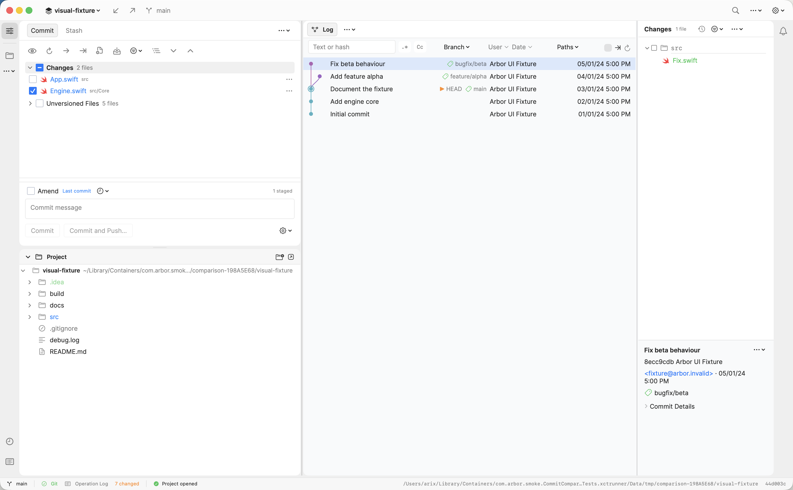
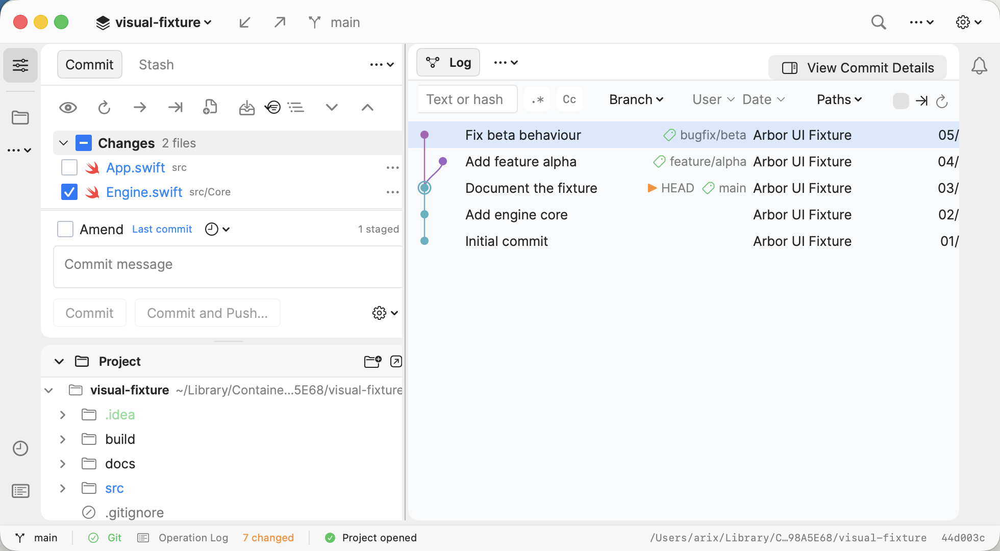
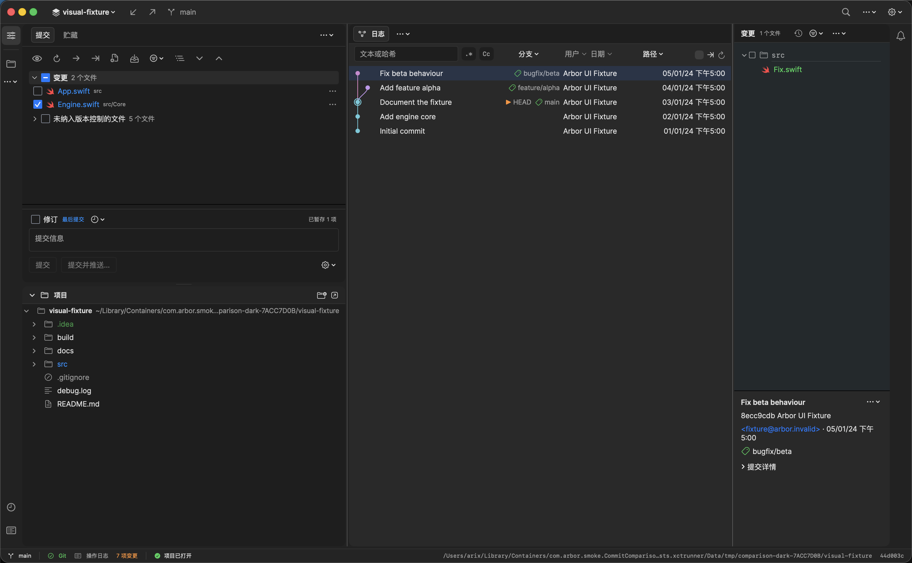

# Commit 主窗口 UI 对齐：第三轮

日期：2026-10-24。参照：本机 Rebased 1.1.13；Arbor 1.0.24，源码基线 500cc06，叠加前三轮未提交改动。

本轮收敛第二轮报告列出的字体、复选框、交通灯、图线、日期与右侧文字细节。英文主图来自实际运行的最终应用窗口，选中 Fix beta behaviour（8ecc9cdbd0131ef547b865a38324c12256870879），使用原 visual-fixture 的完整临时副本。

## 本轮修改

| 部位 | 第三轮结果 |
| --- | --- |
| 字体 | 主窗口主要的 12–13 pt 正文、文件名、页签和元数据改用 Inter；部分原生 caption 和等宽代码文字保留原字体。字体来自参考应用随附的未修改 Inter OTF，连同 SIL OFL 1.1 许可证打包；单元测试检查资源及实际注册的 PostScript 名称，避免静默回退。中文缺字由系统字体补足。 |
| 复选框 | 16 pt 空心细边框替代系统厚实的圆角底；选中与部分暂存分别显示勾与横线。使用 Toggle 的 accessibilityRepresentation 保留 checkbox 语义。暂存仍以 Git index 为准。 |
| 交通灯 | 调整真实 NSWindow 标准按钮的位置；中心 x 为 20 / 40 / 60 pt，距窗口顶部 21.5 pt，与 43 pt 标栏居中。 |
| 分支图 | 颜色从几何 lane 中独立出来，预留分支/HEAD 颜色并沿父提交继承；同一 lane 上的 bugfix 与 main 不再同色。此 fixture 为粉、紫、青三色。曲线改为连续 cubic，绘制与命中复用同一路径。 |
| 日期 | 日志和紧凑详情使用两位年、月日和 12 小时制短时间；时区跟随系统，时段词及顺序跟随应用语言。英文为 05/01/24 5:00 PM，中文为 05/01/24 下午5:00。参照的英文截图使用系统中文时段词，Arbor 将这一点统一为应用语言。语言切换测试覆盖英文 → 中文 → 英文。 |
| 元数据 | 标题保持半粗体；作者和日期使用正常正文层级，邮箱为蓝色、引用图标为绿色，详情操作仍收纳在菜单及 DisclosureGroup 中。 |
| 文件图标 | Swift 类型图标统一为红色；文件名继续表达 Git 状态，Project、Changes、提交详情共用同一类型识别和图标色。 |
| 背景 | 浅色 Log 面板略向参考的冷灰底调整，保留独立深色值。 |
| 窗口最小高度 | 手工 AppKit 宿主禁用自动 sizingOptions；SwiftUI 主窗口按实测标题栏高度换算内容最小高度，避免 540 pt 被重复加上标题栏后变成 572 pt。真实应用现已通过 980×540 pt 截图验收。 |
| UI 测试驱动 | Settings、粘贴、菜单关闭和窗口关闭使用菜单及鼠标控件；移除 suite 中 typeKey/typeText，避免此前 testmanagerd 触发第三方输入法授权。剪贴板在粘贴后恢复。未删断言或为通过测试增加跳过条件。 |

## 完整回归发现并修复的问题

测试服务恢复后，首轮完整 UI 实际执行 20 项：15 通过、4 失败、1 项诊断用例按原配置跳过。失败集中在 Commit / Log / Project 控件扫测及 Settings 入口，按失败截图和辅助功能树定位后做了以下修复：

| 问题 | 修复与原因 |
| --- | --- |
| Commit 活动栏被读成 Edit | 显式提供本地化名称和当前选中状态，使按钮准确表达用途，已选中项也能被识别。 |
| 手动刷新相同日志后没有完成反馈 | 等待本次加载任务完成后显示“日志已刷新”；取消、过期请求和加载失败不显示成功。后台自动加载不增加通知。 |
| 不同分组共用 chevron.right 标识，测试点到错误箭头 | 测试定位同时匹配标识与名称。失败截图显示 Unversioned Files 已被暂存操作移走，旧定位却点到空 Changes 组的同名图标；保留原有响应断言。 |
| Settings 菜单查询找不到实际菜单项 | 按系统菜单暴露的 title 查询 Settings…，替换不匹配的 label 查询；修复后设置页单项已通过。 |
| 截图继承前面拖拽测试的面板宽度 | 截图用例显式固定展开状态及布局参数，使每次采集的空间分配可重复。 |
| 独立宿主支持 540 pt，真实 SwiftUI 主窗口仍被限制在 572 pt | 最终受控截图测试复现失败；按窗口的实际标题栏高度换算内容最小值，修复后同一测试通过。正式 UI 套件另增加缩到低于最小高度后必须停在 980×540 pt 的断言，防止只验证辅助宿主。 |

## 交付前重点复核

1. **自绘复选框好看但失去操作语义。** 正式 XCTest 已读取 Stage 文件、组级和 Amend 的 checkbox 角色、名称和值；真实点击覆盖未暂存 → 暂存 → 部分暂存 → 暂存 → 取消暂存，以及 Unversioned / Changes 整组操作。Commit Options 的 Skip hooks 开关也通过。独立原生宿主另以窗口鼠标事件和直接读取 Git index 验证暂存往返；本轮没有进行人工 VoiceOver 朗读体验测试。
2. **图色按 OID 合并到其他仓库，或折叠后变色。** 新单元测试覆盖两个仓库具有相同 OID、同 lane 三个引用、tag 继承、merge 的两个父方向、简单分页和折叠缓存。图的拓扑与 lane 计算保持原逻辑。测试不等于所有大型仓库的配色都与 Rebased 相同。
3. **字体资源进了项目却未加载。** 测试验证两份 OTF 和 OFL 都在主 bundle，NSFont 能按 Inter-Regular / Inter-SemiBold 查到相应字体。代码使用准确 PostScript 名称，避免将 Inter 当成无效 family 名。
4. **辅助宿主通过，真实窗口仍无法缩到 540 pt。** 此项在最终 XCTest 中实际复现并修复；三张最终图片均改由正式应用采集。980×540 pt 图内保留提交按钮及状态栏；正式 UI 套件增加最小尺寸断言。交通灯通过原生坐标断言及实际窗口截图复核，分隔线拖拽与宽度恢复由 UI 测试验证。
5. **中文界面残留英文日期、或深色对比度不足。** 日期回归显式使用两种 locale，并检验切回英文；中文深色截图单独复核。仓库名、提交主题、分支名和 HEAD 等 Git 标识保留原始内容。

## 截图与对照条件

- 主窗口：1642×1015 pt，PNG 3284×2030 px。顶部栏 43 pt，左活动栏 40 pt，Project 起点约 516 pt，Log 行距 26 pt，右详情 280 pt 加 40 pt 通知栏。
- 主图使用相同项目名 visual-fixture，选中相同提交，文件计数 1 file；原始 fixture 不参与暂存或提交操作。
- Rebased 沿用原审计的匹配基线，不将旧图描述为本轮重新采集。
- 临时副本路径、Project 展开状态、其他编辑页签，以及 Git 暂存与 Rebased 提交包含勾选的语义差异，继续按前两轮报告的口径排除。

### Rebased 基线

### 第二轮

### 第三轮

### 窄窗口

实际为 980×540 pt（1960×1080 px），来自正式应用窗口。XCTest 通过真实鼠标拖拽缩放，断言窗口尺寸和提交按钮位于窗口内；Commit 按钮和底部状态栏均可见。变更列表与 Project 保留各自的滚动，日志表格保留横向滚动。窄窗详情改由 View Commit Details 打开。

### 中文深色

实际为 1642×1015 pt（3284×2030 px），检查中文组名、文件计数、暂存数、日期、提交详情和状态栏。

上面三张最终图片均来自最新正式 Arbor.app，由受控 XCTest 采集；主图与中文深色图为 1642×1015 pt，窄窗为 980×540 pt，均打开原始 visual-fixture 的临时完整副本，选中同一提交。中文深色采集结束恢复原外观。它们替换了此前的主图及独立宿主窄窗、深色图。

受控截图结果位于忽略的 build/ui-compare-20261024/round3/final-verification/matched-delivery.xcresult，附件导出至同目录的 matched-delivery-captures；没有把采集入口加入产品。先前独立宿主的交通灯坐标与 Git index 检查仅保留为补充证据。Rebased 深色基线未重新采集，本轮深色图用于检查 Arbor 自身。

## 全量测试与实际边界

最终源码的 Swift 全量及完整 UI 套件均已通过。此前四个 UI 失败用例已修复；随后发现的真实窗口最小高度问题也已修复，并补入正式回归断言。

| 检查 | 结果 | 证据（相对于 build/ui-compare-20261024/round3） |
| --- | --- | --- |
| cargo fmt --check | 通过 | 按 CI 的第一道检查执行 |
| Rust cargo test --all-targets | 838 通过、0 失败、1 原有忽略，退出码 0 | rust-full.log，62 个测试组；此后未再修改 Rust |
| Rust 忽略项 | compares_all_50k_history 按原配置忽略，未计入通过 | 日志标注 manual v0.11 performance gate |
| Rust release / Swift bindings / Xcode 工程生成 | 通过；生成的 Swift bindings 无源码差异 | rust-release.log、bindings.log |
| 最终 Swift 全量 | 736 通过、0 失败、0 跳过，退出码 0；包含图色、跨仓库 OID、字体及语言切换的 5 项新回归 | final-verification/ 下的 swift-window-fixed.xcresult、swift-window-fixed.log、swift-window-fixed-summary.json |
| 最终完整 UI 套件 | 18 通过、0 失败、2 跳过，退出码 0；共 20 项，包含新增最小尺寸断言 | final-verification/ui-window-fixed/20261024-150835.xcresult；日志与摘要位于 final-verification/ 下的 ui-window-fixed.log、ui-window-fixed-summary.json |
| 受控同页截图与交互 | 2 通过、0 失败、0 跳过；正式应用主图、980×540 窄窗及中文深色成功，窗口尺寸及提交按钮边界断言通过 | final-verification/ 下的 matched-delivery.xcresult、matched-delivery.log、matched-delivery-captures |
| 复选框辅助功能及暂存语义 | 正式 XCTest 通过，读取角色、名称和值，点击覆盖暂存、部分暂存、组级操作及取消暂存 | 完整 UI 中的 testChangesGroupingPreservesStagingAndPartialState、testCommitOptionCheckboxesToggle |
| 真实分隔线、窄窗、筛选与长主题 | 最终完整 UI 全部通过；请求 980×500 时实际停在 980×540，提交按钮保留在窗口内 | testCaptureArborCommitAndLog、testCompactLogPreservesSelectionAndDividerWidths、testLogFiltersStayInsidePane、testLongCommitSubjectsStayInsideTheirRows、作者/日期及路径筛选用例 |
| 新增硬编码文案、文案入口审计与目录 JSON | 通过，未更新审计基线；相对源码基线新增的 17 条目录键均有中文译文 | final-verification/ 下的 i18n-hardcoded.log、surface-audit.log；xcstrings JSON 校验 |
| 完整翻译目录审计 | 仍有历史缺口：380 个未登记键、125 个缺少中文的键；原始 HEAD 为 381 / 125，本轮未新增缺项 | final-verification/ 下的 i18n.log、i18n-head.log；不是全应用翻译完成的证明 |
| 差异及原始 fixture | git diff --check 通过；原仓库和截图副本均保持 2 个已跟踪变更、5 个未跟踪文件 | 未执行提交、推送或发布 |

两项 UI 跳过分别为：未传 --focus 时按原配置跳过的单控件诊断 testFocusedControlReacts，以及 Rebased 未运行时跳过的参考端截图 testCaptureRebasedCommitAndLog。它们未计入通过；最终视觉对照沿用已核对尺寸与提交的 Rebased 基线。此前运行器连接超时未再出现，最终结果来自实际执行的用例。

Settings 已能通过真实菜单打开，并成功验证 Test Git executable 和 Save Git executable。控件扫测受既有时间预算及网络、系统面板等策略约束，不能将整套测试通过解释成每个设置控件或所有 Git 工作流都被遍历。没有进行人工 VoiceOver 朗读体验测试；复选框的 XCTest 辅助功能语义已通过。

最终受控截图曾在真实主窗口复现 572 pt 下限，随后修复并用同一测试验证为 540 pt；这也是补入正式最小尺寸断言后再次重跑全套 UI 的原因。较早的独立宿主截图不再替代实际应用窗口的尺寸验收。

## 最终对照结论

固定主窗口布局保持：顶部栏 43 pt、左活动栏 40 pt、Project 起点约 516 pt、日志行距 26 pt、右侧详情 280 pt 加 40 pt 通知栏。字体、复选框轮廓、分支图曲线及配色、日期和提交元数据已收敛；同一提交的文件计数现为 1 file，原来的目录容器重复计数已修复。

本报告不宣称与 Rebased 逐像素一致。仍有品牌图标、原生 SF Symbols、HEAD 标记和少量原生 caption 的差异；Arbor 的勾选表达 Git index 暂存，参考端表达提交包含。英文日期使用 PM、中文日期使用“下午”，明确跟随应用语言。未复制 IDE 专属编辑页签、Terminal 或 Scratches；中文深色用于检查 Arbor 自身，未与 Rebased 深色基线逐项比较。
