# 临时仓库 UI 用户路径验收

日期：2026-10-25 至 2026-10-26。初始源码基线：`a3fe006`，Arbor 1.0.24。用户路径修复已随 `4f7dc73` 推送；Swift 5.10 CI 兼容修复已随 `17f1c80` 推送；分支弹窗语言修复和最终截图随 `681bd50` 推送。`1.0.25` 发布准备提交为 `3126162`，已通过完整 CI。2026-10-26 追加的多仓库中文验收、跨仓库合并入口修复、Merge sheet 文案本地化与输入法回归仍在工作区，尚未提交。

## 结果清单

| 分类 | 结论 |
| --- | --- |
| 已通过 | 三组 Git 路径均已通过真实界面操作，并用 Git 核对提交、索引、文件、分支和本地远端。部分暂存修复后专项通过。 |
| 已通过 | 中文冲突面板在 980×640 窗口内完成接受 Theirs → 标记已解决 → 完成 Merge；三栏标题显示中文。 |
| 已通过 | Rust 恢复相关测试 47 项；本轮最终 Swift 单元测试 736 项、应用构建和文案审计通过。验证时间边界见末尾。 |
| 已通过 | 最后追加的中文数量断言已复跑：`1 个冲突文件`、`已选择 1 项`和原生三栏标题通过，实际完成 Merge，Git 状态干净。 |
| 已通过 | 分支弹窗英文专项 1/1、980×640 中文专项 1/1；三处主要入口各一个、长分支搜索可达、Actions → Merge → 取消实际完成。 |
| 已通过 | 分支弹窗修复后的 Arbor / Rebased 配对截图专项 1/1，附 Rebased 控件树；窗口同宽，高度相差 25 pt。 |
| 已通过 | 多仓库中文分支弹窗 980×640 专项 1/1：两仓库列表、仓库筛选、长分支搜索和跨 root 合并入口均可达；取消后两仓库 HEAD、分支和工作区不变。 |
| 已通过 | 完整用户路径套件 12/12；宿主中文输入法保持激活时复跑仍通过，文本输入已改为 Edit 菜单粘贴。 |
| 已通过 | 中文 Pull、Push 与项目 Git 设置页实测：Pull 选项菜单、Push 标签模式、设置弹窗标题与 picker 均显示中文；完整套件扩到 13/13。 |
| 已通过 | 现有代码已提交并推送 `origin/main`；包含本轮全部修复的 `3126162` 已通过 GitHub Rust / Swift 完整 CI。 |
| 操作受阻 | 当前无执行阻塞。此前审批拒绝已解除，提交、推送、构建、UI 执行和附件导出均已恢复。 |
| 与 Rebased 行为不同 | 首次打开同一临时仓库，Rebased 1.1.13 要求确认项目可信，Arbor 直接进入工作区。本轮保留这一流程差异。 |
| 与 Rebased 行为不同 | Arbor 已移除重复入口，仍保留独立标题、说明和底部 Actions 菜单；Rebased 搜索位于最上方，主要操作和分支放在同一棵树中。默认尺寸及目录树样式仍有差异。 |

macOS 的 Enable UI Automation 身份验证已完成，后续用户路径测试正常运行。用户也已确认 Rebased 的 Trust Project，目标临时仓库已打开。

2026-10-26：切换为默认权限后，执行审批恢复。此前工具返回的 `rejected by user` 不能据此认定用户点击了拒绝；本报告不再把已解除的审批问题列为产品阻塞。

## 方法与范围

`ArborUIUserFlowUITests` 为每项测试建立独立临时工作区和本地 bare remote。文件修改由 fixture 注入；克隆、暂存、提交、Push、分支、冲突与恢复动作通过实际菜单和按钮执行。每步之后使用 Xcode 附带的真实 Git 核对结果。

Push/Fetch/Pull 用户路径的远端均为临时本地仓库，HTTPS/SSH 身份验证不在该套 UI 用例覆盖内。Arbor 项目本身已通过原生 SSH 推送到 GitHub；这不代表应用内远端身份验证经过验收。临时仓库保留，日志输出 `USER_FLOW_FIXTURE` 和 `USER_FLOW_PASS`。

多仓库用例在同一项目内建立两个 Git root（`frontend` 与嵌套的 `backend`），两者都包含长分支 `feature/localization-audit-with-a-deliberately-long-branch-name`。窗口收缩到 980×640 后，逐项核对仓库计数与筛选、长分支搜索、行内菜单的“在多个仓库中合并…”入口、中文 Merge sheet，以及取消后的 Git 状态。

测试输入通过 Edit → Select All → Paste 完成并校验字段值，避免 XCTest 直接键入时被宿主输入法组合成中文。排查中确认：宿主切到简体拼音后，键盘事件会打开候选窗口、字段保持为空，首轮完整套件因此有 7 项失败；改为菜单粘贴后，在拼音输入法保持激活的情况下完整套件 12/12 通过。

## 已通过的具体操作

| 用例 | 路径 | Git 核对 |
| --- | --- | --- |
| 01 | 打开/克隆 → 两处修改 → 只暂存一处 → 提交 → Push | index 和新提交仅含选中修改；另一处留在工作区；bare remote main 等于 HEAD。 |
| 02 | Fetch → Pull → 切分支 | Fetch 只更新 origin/main；Pull 更新 HEAD 和文件；切回 topic 后文件树正确。 |
| 03 | Merge → 冲突 → 接受 Theirs → 标记已解决 → 完成 | 双父提交、topic 内容、干净工作区。 |
| 04 | Merge 冲突 → 中止 → 确认 | 原 HEAD、原文件和干净状态恢复。 |
| 05 | Rebase → 冲突 → 解决 → 继续 | main 的新提交以 topic 为父提交，保留当前修改，工作区干净。 |
| 06 | Rebase 冲突 → 中止 → 确认 | 原 HEAD、main 和文件内容恢复。 |
| 07 | 历史 Diff → Cherry-pick → Revert → Mixed Reset | Diff 包含目标内容；反向提交删除目标文件；Reset 移动 HEAD、清空 index，保留本地文件。 |
| 08 | Stash 保存 → Pop 并恢复暂存状态 | stash 清空，原 staged/unstaged、index diff 和文件内容恢复。 |
| 09 | 两项目窗口分别操作菜单 | Stash 仅作用于当前项目；关闭第二窗口后首窗口菜单继续可用。 |
| 10 | 980×640 中文冲突工作台 | 主要按钮位于窗口内，实际完成 Merge；三栏标题跟随应用语言。 |
| 11 | 980×640 中文多仓库分支弹窗 | 仓库筛选与长分支搜索可达；取消跨仓库 Merge 后两个 root 的 HEAD、当前分支和 status 均未变化。 |
| Fixture | 创建与检查临时远端 | 初始状态干净，origin/main 与 HEAD 一致。 |

主套件在部分暂存修复前为 10/11；唯一失败项是部分暂存按钮位于横向滚动区域外，修复后用例 01 专项为 1/1。2026-10-26 追加多仓库用例后套件共 12 项，最终整体复跑 12/12 通过；克隆、部分暂存、提交、Push 等全部 Git 断言均在这次运行中重新核对。

## 按影响修复

1. **Merge 中止留下冲突标记。** 原实现只重建 index，未恢复文件。现在先刷新 gix index 的文件 stat，再用 `git reset --merge <ours>` 同步恢复；回归验证冲突文件复原、合并新增文件删除、无关 tracked 修改及 untracked 文件保留。
2. **Rebase 继续启动命令行编辑器。** 保留已有消息编辑脚本；无脚本时设置 `GIT_EDITOR=true` 接受已有消息。回归刻意设置 `core.editor=false`，仍能继续且保持提交消息。
3. **AppKit 启动窗口的 VCS 菜单禁用。** 菜单上下文绑定实际 key window，通知携带目标项目路径；两项目窗口测试核对作用目标。
4. **部分暂存受侧栏宽度限制。** 复用 Diff 编辑器打开弹窗，主暂存按钮固定在横向滚动区外。900 pt 宽弹窗验证选中行、按钮边界、index、提交及 Push。
5. **File 菜单重复、Pull 默认分支错误。** 项目入口使用系统 File 命令组；Pull 复用正确的远端前缀解析。
6. **中文冲突面板溢出。** 浮层尺寸随窗口收缩；单 root 隐去重复 root 列；次要工具可横向滚动，标记已解决、完成和中止保持可见。
7. **分支弹窗列表被重复按钮挤压。** 去掉底部重复的 Commit / New Branch / Checkout 入口，其余底部操作收入 `Actions` 菜单，保持已有回调和禁用条件。英文及中文专项均通过：列表视口实测 380 pt，首屏本地分支标题可见，长分支搜索可点击，菜单实际打开 Merge 后取消。
8. **中文主窗口打开英文弹窗。** 向单仓库及多仓库分支弹窗显式传递应用 locale，并本地化动态动作标题；Merge sheet 同样传递 locale。单仓库中文专项核对三处主要动作、分组、底部菜单及“取消”按钮。多仓库专项已补做：980×640 下仓库筛选、长分支搜索、跨 root 合并入口与中文 Merge sheet 均通过。
9. **目录分组后跨仓库操作使用短分支名。** 按目录分组时，行菜单把用于显示的短名称传给 Git 操作，`feature/...` 的“在多个仓库中合并…”入口因此消失。现在行数据保留完整名称，只有显示层使用短名称；专项用例按完整名称打开跨 root Merge 并取消。
10. **多仓库 Merge sheet 未继承语言，策略标题不可翻译。** sheet 没有拿到应用 locale，`strategy.title` 等动态标题又以 `String` 传入，无法进入 catalog。现在向 sheet 显式传递 `appLocale`，策略与选项标题改用 `LocalizedStringKey`，补齐“位于 %@”“没有贮藏”及 5 条策略/选项翻译；中文截图核对“自动（可用时 fast-forward）”。
11. **用户路径测试依赖宿主输入法。** `enter` 原先直接 `typeText`，宿主为拼音输入法时 ASCII 被组合、字段为空，7 项用例连锁失败。现在通过 Edit → Select All → Paste 替换内容并校验重试，同时保留与恢复剪贴板。
12. **Pull/Push 等 sheet 不继承应用语言。** 只有 Merge sheet 曾显式传入 locale，Pull、Push（含多 root）和凭据弹窗仍是英文。现在这些 sheet 都显式应用 `appLocale`；「项目 Git 设置」同样处理。中文实测覆盖 Pull 选项菜单、Push 标签模式与设置弹窗标题。
13. **Push 按钮硬编码中文和英文选项。** `Button(remotes.isEmpty ? "提交" : mode.actionTitle)` 在英文界面也显示「提交」；改为本地化键。同时补齐发布分支、Push 标签、自定义 refspec、待推送提交计数、用户名/口令/钥匙串等中文；策略与选项标题改用 `LocalizedStringKey`。
14. **翻译补充文件重复键静默覆盖。** `scripts/i18n-zh-hans-additions.json` 中 `Push tags` 出现两次，后者把新译文覆盖回英文；已删除重复项。静态审计只看 catalog 覆盖，发现不了这种重复，后续应加入重复键检查。
15. **项目 Git 设置弹窗尺寸溢出（未修复）。** 弹窗固定宽 500 pt，内容高于窗口且部分控件与底部按钮在可视区外，截图可见右侧帮助文本被裁切。本轮只确认中文化，不声称该页布局已验收；建议单独改成有限高度 + 内部滚动。

Reset 测试等待 HEAD、index 和恢复快照全部就绪后再核对结果，避免将生成快照时的临时暂存误判为最终状态。分支搜索测试复用已有菜单粘贴方法，避免直接键入触发本机输入法授权提示；菜单定位只匹配有可见边界的 Merge 项，排除隐藏的同名 VCS 菜单。

## 多语言与布局

前轮新增 93 个 catalog key，补齐 2 个既有数量条目的中文。本轮页面实测又发现 3 个已登记但中文值仍为英文的分组：`RECENT`、`TAGS`、`STASHES`，现改为“最近”“标签”“贮藏”，并同步翻译补充文件。审计扩大到 Picker、Section、GroupBox、ProgressView、alert、confirmationDialog、navigationTitle，以及原生界面使用的 `localizedArborString`。

最终审计：扫描 1,632 处字面量；未登记 key 0，缺 zh-Hans 0，硬编码中文 0。上述三个分组的新翻译经过最终中文 UI 专项核对。多仓库专项又发现两处英文占位：`in %@` 无中文、`No stashes` 的中文值仍是英文，现改为“位于 %@”“没有贮藏”；Merge 策略与选项标题原先以 `String` 传入，已改为 `LocalizedStringKey` 并补齐 zh-Hans。静态审计检查登记及翻译字段覆盖，不能判断英文占位是否真正翻成中文，也不能保证动态文案继承了应用语言，因此仍需页面验收。

原生三栏标题显式使用应用所选语言的资源 bundle；语言更新只更新标题，保留结果编辑内容。截图还发现动态数量、顶部操作标题和恢复提示采用不同语言来源，已针对这些位置补齐。最终应用中的 zh-Hans 资源已核对数量、结果标题、安全合并统计和恢复提示。最后新增的数量 UI 断言已通过；最新截图确认顶部操作标题、安全合并统计和底部恢复提示均显示中文。

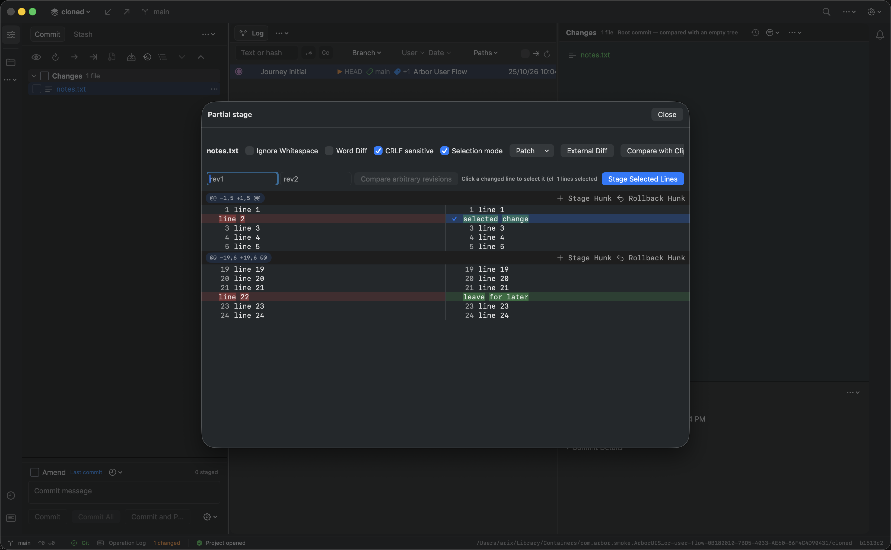

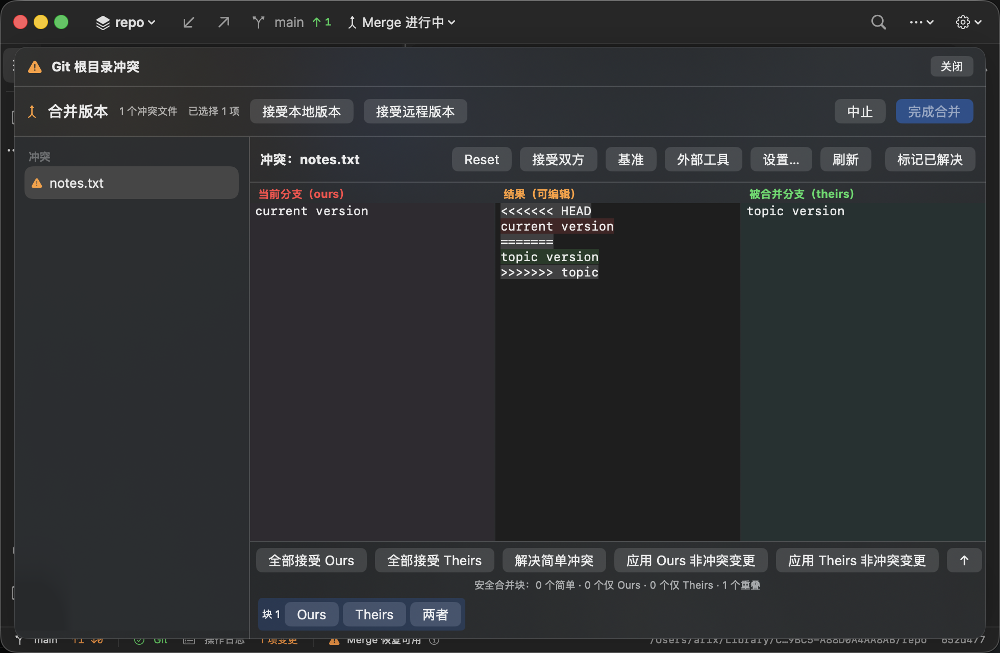

中文截图已更新为最后一次通过的专项结果，包含新增数量和恢复提示翻译。

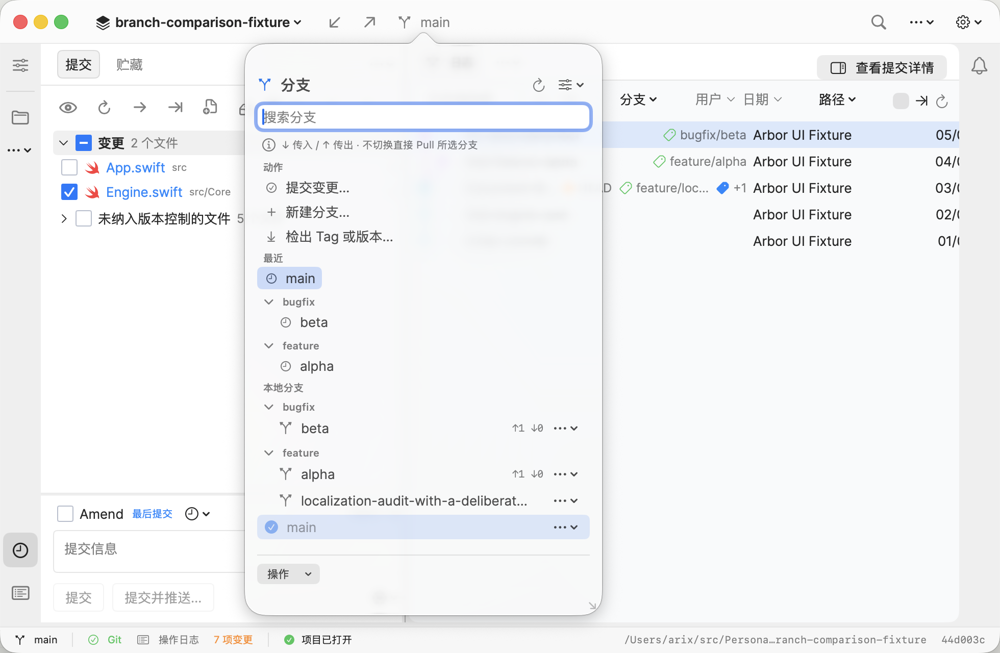

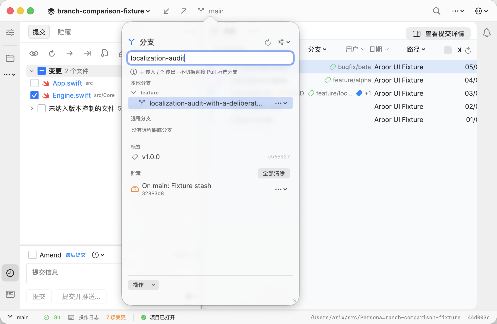

中文分支测试核对主要入口各一个、本地分组及长分支行位于列表边界内、长分支可点击、底部操作菜单位于窗口内；搜索后“标签”“贮藏”分组可见。实际打开 Merge 并点击“取消”。长分支行按可用宽度截断，完整名称保留在无障碍标签中。

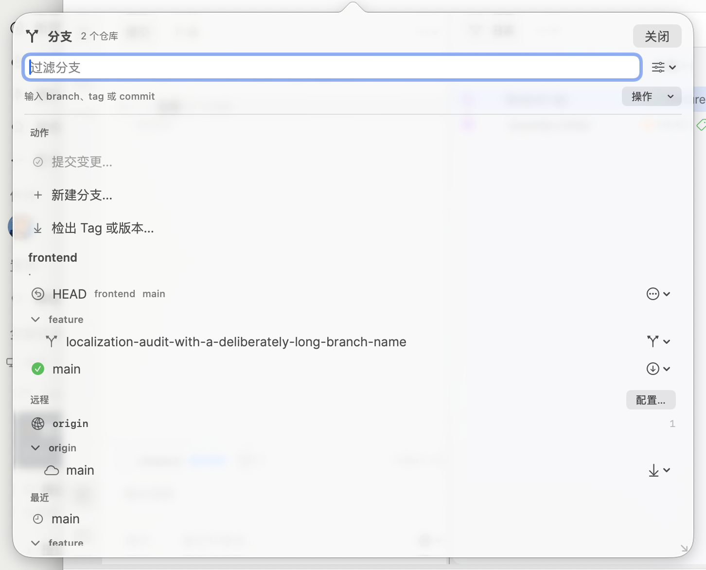

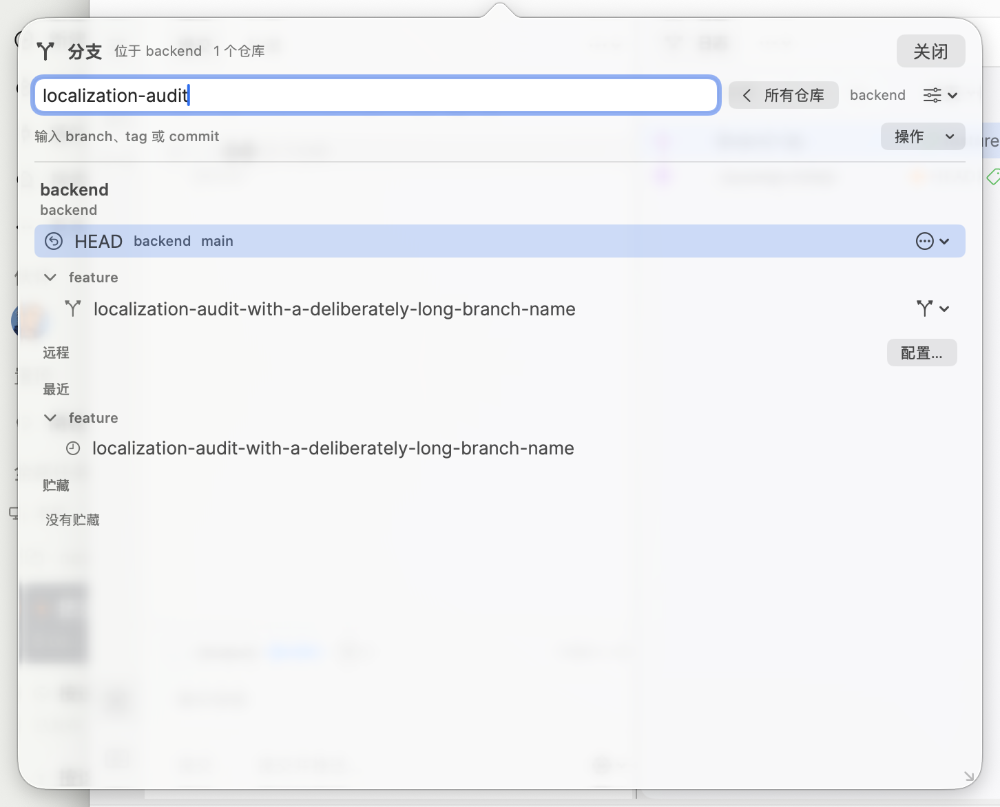

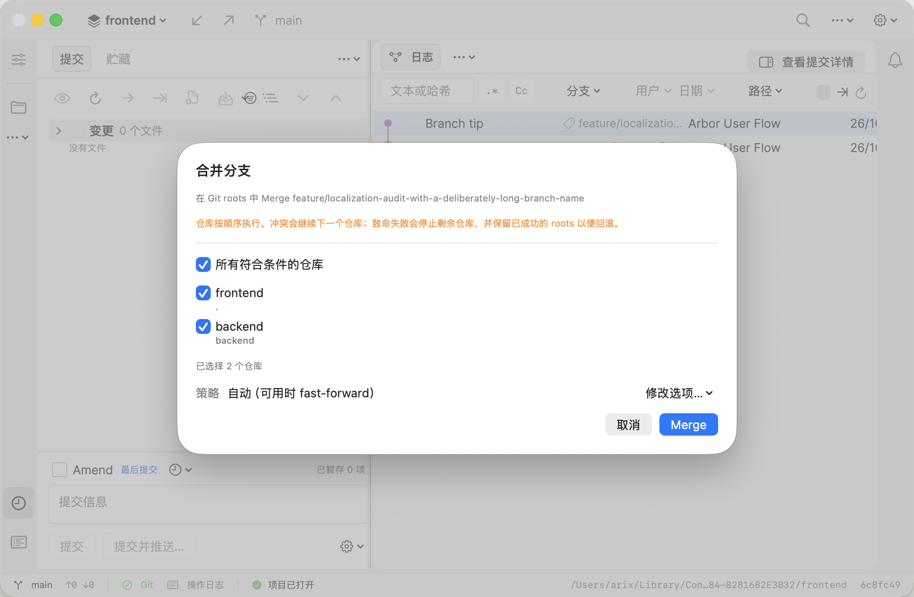

多仓库弹窗在 980×640 窗口中实测 726×586，未筛选时分支列表视口 435 pt，标题行显示“2 个仓库”；筛选到 backend 后显示“位于 backend”与“1 个仓库”。底部“操作”菜单与“取消”按钮均在边界内。跨 root 合并入口使用完整分支名，sheet 显示“在 Git roots 中 Merge feature/…”和“已选择 2 个仓库”。点击“取消”后两个 root 的 HEAD、当前分支和工作区均未改变。

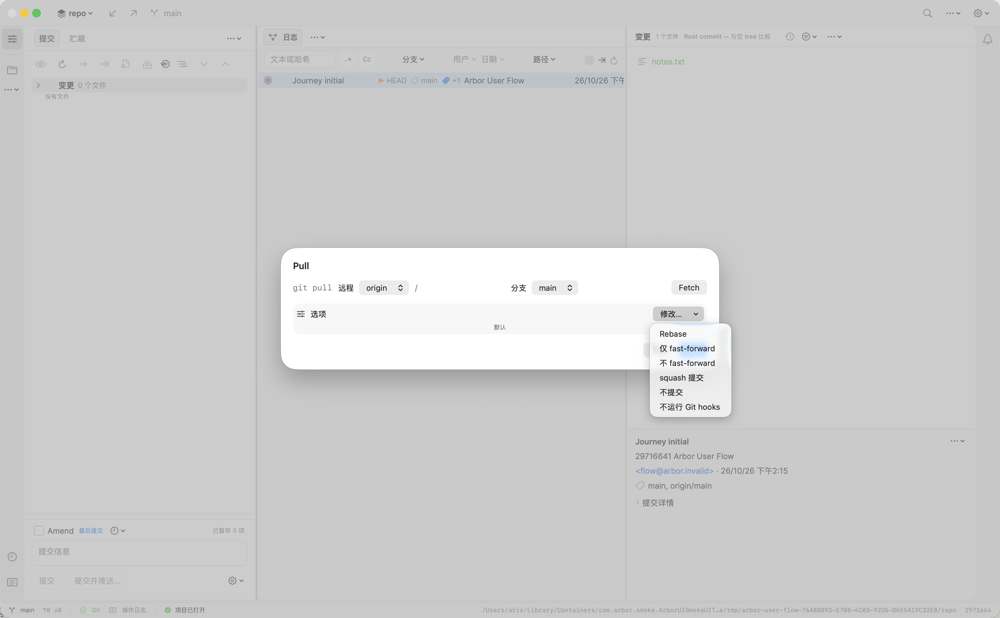

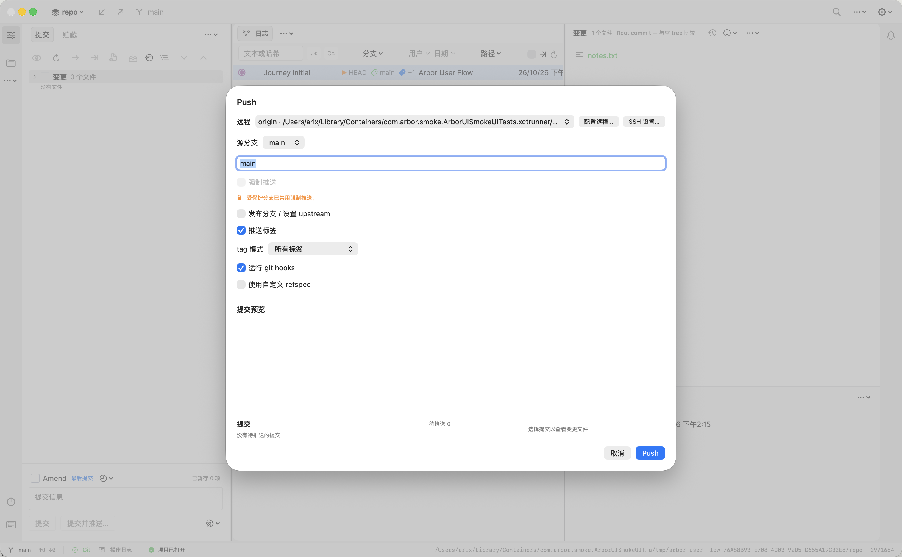

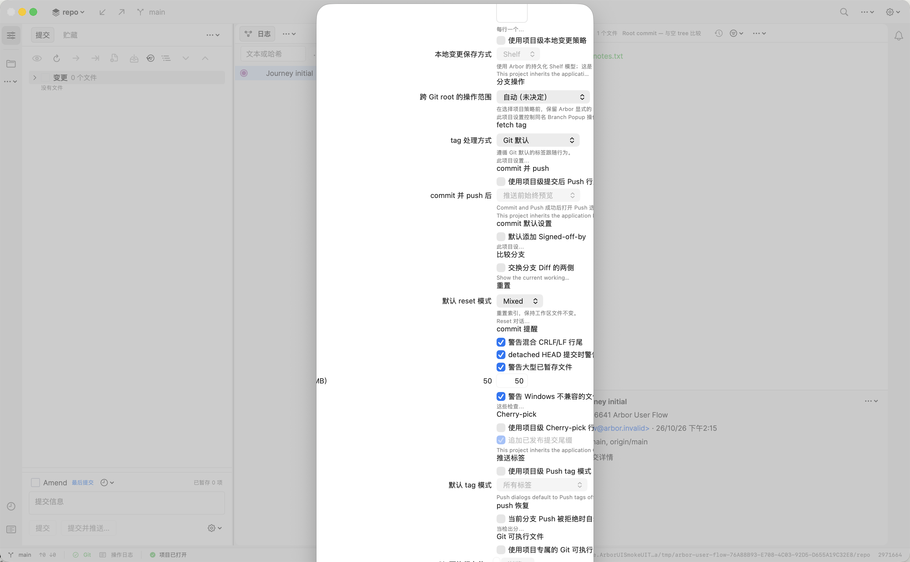

Pull 弹窗实测“选项”摘要显示“默认”，`修改…` 菜单列出“仅 fast-forward”“不 fast-forward”“squash 提交”等中文选项。Push 弹窗的标签模式显示“所有标签”，待推送计数显示“待推送 0”。两者标题与主按钮仍为 `Pull` / `Push`，与术语表保留英文 Git 术语的约定一致。

## 分支弹窗 UI 对照

共享 fixture 为 `.build/UISmoke/branch-comparison-fixture`，包含长分支 `feature/localization-audit-with-a-deliberately-long-branch-name`。用户确认 Trust Project 后，已取得双方分支弹窗截图。

修复后重新采集的窗口实测：Arbor 为 1642×1015，Rebased 为 1642×1040；Rebased 高度未能通过本轮拖拽调整到目标值。因此只对照同宽窗口内的弹窗结构，不声称双方完整窗口逐像素一致。最新两图均为浅色主题。

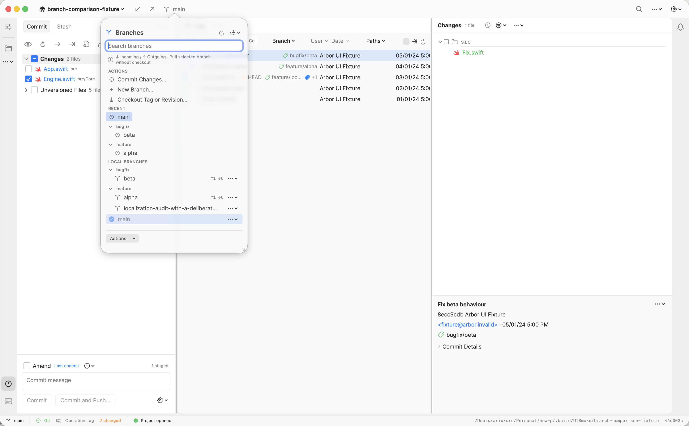

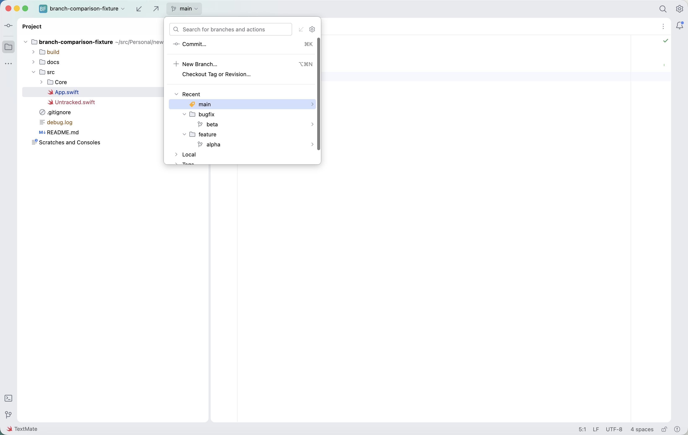

| 项目 | Arbor 本轮修复后 | Rebased 1.1.13 |
| --- | --- | --- |
| 弹窗尺寸 | 默认内容 350×560，来自源码设置；中文 AX 含外壳为 376×586 | 375×353，来自最新无障碍树 |
| 顶部 | 独立 Branches 标题、搜索框、说明文字 | 搜索框与 Fetch / Settings 同行 |
| 主要操作 | Commit、New Branch、Checkout 各一个列表入口，其余底部操作收在 Actions | Commit、New Branch、Checkout 各一个列表入口 |
| 列表空间 | 实测视口 380 pt；首屏可见 Local 分组及多行分支，底部只保留一个菜单 | 树视口 305 pt，行高 24 pt；Recent 下可见多行，Local 可折叠 |

已完成列表空间、长分支搜索与截断、Actions → Merge → Cancel、中文分支弹窗的实机回归，上方配对图片已替换为修复后截图。标题、搜索框位置、默认尺寸和目录树样式仍未全部对齐；后续 UI 迭代可从这一页继续。

## 1.0.25 发布核验

`v1.0.25` 指向已通过完整 CI 的 `3126162`。[正式发布页](https://github.com/arixbit/Arbor/releases/tag/v1.0.25) 已生成；[发布构建 40260101456](https://github.com/arixbit/Arbor/actions/runs/40260101456) 成功，沿用 unsigned arm64 分发渠道。

- 下载正式 DMG、ZIP 和 `SHA256SUMS`，两个安装包的 SHA-256 均与清单及 GitHub 资产摘要一致；DMG 通过 `hdiutil verify`。
- 从正式 ZIP 提取应用，核对版本号与构建号均为 `1.0.25`，架构为 arm64，最低系统为 macOS 14.0；抽查 5 条中文资源，Inter 两个字体及 OFL 许可证与源码一致。
- 只读挂载正式 DMG，核对 Applications 链接正确，包内全部 11 个应用文件与已验证的 ZIP 完全一致；核验后已卸载镜像。
- 主仓库 `Casks/arbor.rb` 使用正式 DMG 的版本和校验值。独立 `arixbit/homebrew-arbor` 仓库返回 HTTP 404，继续使用 README 中以 Arbor 主仓库为远端的 Homebrew 安装方式。

## 交付前对抗审查

按最容易产生错误结果的顺序复查：

1. **恢复丢失无关修改。** Merge 回归同时核对 tracked 编辑、untracked 文件和合并新增路径；16 项 merge 测试通过。
2. **Rebase 改消息或依赖外部编辑器。** `core.editor=false` 回归通过，并额外核对原提交消息；9 项 rebase 测试通过。
3. **按钮存在但点击无效。** 部分暂存增加弹窗边界断言，以真实 index、提交、Push 核对执行结果；中文页以完成 Merge 验证可达性。
4. **菜单作用于错误项目。** 两窗口分别 Stash，另一仓库保持原状态，并验证关窗后首窗口继续工作。
5. **中文遗漏、隐藏菜单误匹配或验证结论过度。** 英中 UI 专项均实际打开可见 Actions 菜单的 Merge 并取消；中文专项同时核对本地化入口、分组与边界，发现并修复静态审计未识别的英文占位。多仓库中文已由本轮专项覆盖，完整套件 12/12；应用内远端身份验证仍不在本轮实测范围。配对截图保留真实窗口高度差异，UI 专项和云端 CI 分别记录。
6. **测试依赖宿主输入法。** 宿主拼音输入法激活时，直接键入会被组合成候选而留下空字段，首轮完整套件 7 项失败。输入已改为 Edit 菜单粘贴并校验；拼音激活状态下完整套件复跑 13/13。
7. **弹窗语言未随应用切换。** Pull/Push/凭据/项目 Git 设置此前未拿到 `appLocale`；中文主窗口仍显示英文控件。现已在各 sheet 显式传递 locale，并由中文专项截图核对。项目 Git 设置弹窗的尺寸溢出作为已知问题保留，不作为本轮已修项。

## 验证记录与复跑入口

- Rust：先通过 cargo fmt --check；merge 16、rebase 9、reset 19、user_journeys 3，合计 47 项通过。新增原消息断言后的 rebase 单项再次通过。
- Swift：本轮最后的 locale、动态标题及三处分组翻译修复后，736 项单元测试通过，0 失败；结果为 `build/user-flow-audit/swift-final-20261026.xcresult`。
- GitHub CI：包含本轮全部修复及 `1.0.25` 版本号的 `3126162` 完整检查成功，运行 [40258911779](https://github.com/arixbit/Arbor/actions/runs/40258911779)。原始日志核对 Rust 843 项、Swift 736 项通过，均为 0 失败。此前 `681bd50` 的单独运行在发布准备提交推送后被取消，其改动由这次成功运行覆盖。
- 主 UI：`build/user-flow-audit/final-journeys/20261025-215720.xcresult`。
- 日常提交修复后：`build/user-flow-audit/daily-final/20261025-220355.xcresult`。
- 最终中文专项 1/1：`build/user-flow-audit/chinese-final/20261025-222600.xcresult`。
- 最终英文分支专项 1/1：`build/user-flow-audit/branch-layout-final/20261026-100555.xcresult`。之后只追加三处 zh-Hans 翻译及中文条件下的断言。
- 最终中文分支专项 1/1：`build/user-flow-audit/branch-layout-chinese-final/20261026-100720.xcresult`，包含三处分组翻译的最终断言。
- 修复后分支配对截图 1/1：`build/user-flow-audit/branch-parity-final/20261026-100832.xcresult`。
- 完整用户路径 12/12（含多仓库中文专项；拼音输入法保持激活）：`build/user-flow-audit/user-flow-final-ime2/20261026-122219.xcresult`；多仓库截图与控件树保留在 `user-flow-final-ime2-attachments`。
- 输入法问题复现记录：`build/user-flow-audit/user-flow-final-20261026/20261026-115949.xcresult`，该次因直接键入被拼音输入法组合而失败 7 项。
- 本轮改动后的 Swift 单元测试 736 项 0 失败：`build/user-flow-audit/swift-unit-20261026b.xcresult`。
- 中文 Pull/Push/设置专项（含设置弹窗）通过：`build/user-flow-audit/dialog-zh-12/20261026-141555.xcresult`；完整用户路径 13/13：`build/user-flow-audit/dialogs-final2/20261026-141753.xcresult`；改动后 Swift 736 项：`build/user-flow-audit/swift-unit-dialogs.xcresult`。
- 导出截图、无障碍树和清单保留在 `build/user-flow-audit/`。
- 最后追加的中文数量 UI 断言已执行通过；恢复提示同时经过最新截图核对。

```sh
cargo fmt --manifest-path arbor-engine/Cargo.toml --check
cargo test --manifest-path arbor-engine/Cargo.toml --test merge --test rebase --test reset --test user_journeys
python3 scripts/i18n-audit.py
./scripts/ui-smoke.sh --only ArborUIUserFlowUITests --report build/user-flow-audit/results
```

本轮多仓库专项与完整用户路径复跑入口：

```sh
./scripts/ui-smoke.sh --only ArborUIUserFlowUITests/test11ChineseMultiRootBranchesFitMinimumWindow --report build/user-flow-audit/multi-root-chinese
./scripts/ui-smoke.sh --no-build --only ArborUIUserFlowUITests --report build/user-flow-audit/user-flow-results
```

前三组用户路径、最后中文数量断言、本轮分支弹窗与多仓库回归均已完成；已按要求先推送现有代码，再继续 UI。多仓库中文验收和输入法回归的新改动仍在工作区，待确认后提交。下一轮可继续对齐分支弹窗的标题、搜索和目录树，当前没有待处理的身份验证或 Trust Project 步骤。分支弹窗对照复跑入口：

```sh
./scripts/ui-smoke.sh --only ArborUIVisualCaptureUITests/testBranchPopupReferencesAndActionsStayReachable --report build/user-flow-audit/branch-layout-final
./scripts/ui-smoke.sh --only ArborUIVisualCaptureUITests/testChineseBranchPopupReferencesAndActionsStayReachable --report build/user-flow-audit/branch-layout-chinese-final
./scripts/ui-smoke.sh --no-build --only ArborUIVisualCaptureUITests/testCaptureBranchPopupParity --report build/user-flow-audit/branch-parity-final
```
