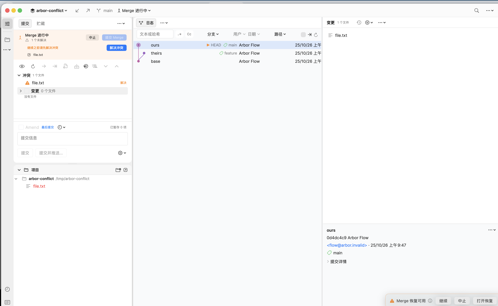

# 用户旅程验收：日常提交 / 分支与冲突 / 历史与恢复

> 本文保留首轮引擎验收记录。系统自动化验证已完成；后续真实 UI 操作、
> 修复结果及 Rebased 同页对照见 [临时仓库 UI 验收](ui-user-flow-audit.md)。

日期：2026-10-25。范围：Arbor 1.0.24 源码基线 `911a94a`。

本轮把三组高频操作按 UI 的真实调用顺序串成旅程，在临时仓库和本地
bare remote 上执行。目的是回答三个问题：整条路径能否走通、哪一步会被
阻塞、以及结果是否和 Rebased 的操作语义一致。

## 方法与环境

- 引擎级旅程：`arbor-engine/tests/user_journeys.rs`，每个用例独立
  `TestRepo`，远程使用 `git init --bare` 的临时目录，不接触用户仓库。
- 仓库级回归：`cargo test --manifest-path arbor-engine/Cargo.toml`
  全量通过（含新增 3 个旅程用例）。
- UI 级自动化：`./scripts/ui-smoke.sh` 在本机被 macOS 的自动化授权拦住，
  XCTest 在 “Enable UI Automation” 系统弹窗处超时，无法点击真实控件。
  因此本轮“操作受阻”只覆盖引擎与界面代码路径，不能宣称已用鼠标走完
  UI；UI 对照需要先授予测试运行器辅助功能权限，或人工在弹窗中允许一次。
- 界面证据：用同一份 fixture 启动 Debug 构建并截图，确认 Commit/Log
  工作区可以打开、Changes/Log 可以加载。冲突页另外用一个真实 merge 冲突
  仓库启动截图，检查中文界面下的合并态工具栏和冲突列表（见下方）。
  启动截图不触发点击，不替代交互测试。

## 已通过

### 日常提交

| 步骤 | 结果 | 证据 |
| --- | --- | --- |
| 打开仓库并读取工作区 | 通过 | `workspace_status` / `status` 返回文件级 staged/unstaged |
| 同一文件两处修改，只暂存一处 | 通过 | `stage_lines` 后 staged=Modified、unstaged=Modified，`git diff --cached` 只含第一处 |
| 提交 | 通过 | `commit_with_options` 生成的提交只包含已暂存 hunk，工作区保留另一处 |
| Push 到 bare remote | 通过 | remote 的 `refs/heads/main` 等于新提交 |

### 分支与冲突

| 步骤 | 结果 | 证据 |
| --- | --- | --- |
| Fetch + 从远程分支落地本地分支 | 通过 | `fetch` 后本地分支指向 `origin/feature` |
| 设置 upstream | 通过 | `branch_set_upstream` 成功 |
| Merge 冲突暂停 | 通过 | `merge()` 返回冲突文件，`merge_in_progress()` 为真 |
| 解决冲突并 Continue | 通过 | 生成双父 merge commit，内容为选中的一侧，状态干净 |
| Rebase 冲突暂停 | 通过 | `rebase(..., Pick)` 返回 paused + conflicts |
| Rebase Abort | 通过 | HEAD、文件内容、工作区状态全部回到 rebase 前 |

### 历史与恢复

| 步骤 | 结果 | 证据 |
| --- | --- | --- |
| 查看提交 Diff / 路径过滤 | 通过 | `commit_diff` 与 `diff_commits_with_paths` 返回目标文件 |
| Cherry-pick | 通过 | 目标分支得到同一提交内容，消息保持 |
| Revert | 通过 | 生成反向提交，消息为 `Revert "two"` |
| Reset soft | 通过 | HEAD 移动，反向变更保留在 index/worktree |
| Stash 保存 → Apply --index | 通过 | 工作区干净，应用后 staged 状态恢复，stash 仍保留 |
| 删除已应用的 stash | 通过 | stash 栈清空，工作区保留变更 |
| 操作结束状态 | 通过 | `operation_state()` 为 None，没有遗留 marker |

## 界面证据：中文合并态

- 顶部 `Merge 进行中`、冲突数 `1 个未解决`、`提交 Merge` / `解决冲突`
  和底部 `Merge 恢复可用` 均显示中文，按钮没有因长中文被截断。
- 左侧冲突列表、右侧 Log/Changes 和提交详情在 980 pt 级别窗口内保持
  原有列宽；工具栏仍在单行内，未见挤压。
- “解决冲突”打开的三栏编辑器需要一次点击，本轮被系统自动化授权拦住，
  因此三栏内部的按钮顺序、标题和块工具栏只在代码层对齐，未截到真实
  消解页面。

## 操作受阻

本轮在引擎侧没有发现“点击后无结果”的阻塞。真实 UI 侧仍有一个环境级
阻塞和一个已确认的界面问题：

1. **UI 自动化被系统授权阻塞（环境）。** XCTest 运行器需要允许
   “Enable UI Automation”，当前机器在弹窗处超时。影响：无法自动验证
   菜单/弹窗/按钮的点击结果；本轮所有“已通过”均指引擎旅程。
2. **冲突工作台的反馈文本曾出现未求值占位符（已修复）。** Apply/Ignore
   patch hunk 后，提示会显示字面量 `(applied + alreadyApplied)`、
   `(candidates.count)`、`(skipped)`，用户看不到真实数量；颜色判断还用
   `feedback.hasPrefix("已")`，在英文界面或译文变化后失效。现在改为实际
   插值，并用显式的成功状态决定颜色。

## 与 Rebased 行为不同

按影响从高到低：

1. **冲突两侧标题与操作语义不一致（已修复）。** Arbor 的合并编辑器曾固定
   显示 `Local (ours)` / `Remote (theirs)`。在 merge 中这还能理解；在
   rebase 中 Git 的 `ours` 是上游/新基准，`theirs` 才是正在重放的本地提交；
   cherry-pick 和 revert 中 `ours` 是目标分支，`theirs` 是被应用的提交；
   stash 恢复时 `ours` 是工作区，`theirs` 是保存的现场。现在标题按操作
   显示：merge 为 `Current branch (ours)` / `<source> (theirs)`，rebase 为
   `Upstream (ours)` / `Your commit (theirs)`，cherry-pick/revert 为
   `Current branch (ours)` / `Picked|Reverted commit (theirs)`；逐块按钮和
   悬停提示也改用 `Ours` / `Theirs`，不再把 `theirs` 一律称为“远程”。
2. **冲突页有大量绕过 String Catalog 的中文。** 包括
   `全部接受本地/远程`、`标记已解决`、`块 n/N`、`应用补丁/远程`、
   `Base（共同祖先）`、`关闭`、`刷新` 以及 patch hunk 反馈。英文界面会
   直接出现中文。本轮已把冲突页和合并编辑器切到英文 key，中文翻译进入
   catalog；同时补上了审计漏掉的 ternary 内文案。
3. **冲突页反馈的颜色语义依赖中文前缀。** 已改为显式成功标志，避免
   “已...”以外的新译文被误判为错误。
4. **失败提示仍使用中文拼接。** 例如 `无法生成 Local Diff：...`、
   `冲突文件已解决或不再存在：...`、`已接受...`。这些不在 i18n 审计的
   直接字面量模式里；本轮已改成英文 key + 插值，后续随 catalog 翻译。
5. **`Base` / `Both` 等动作名称与 Rebased 的 `Accept Yours/Theirs`
   词汇仍不完全相同。** 本轮把冲突侧统一成 Git 原生的 `Ours` / `Theirs`，
   与 Rebased 的 `Yours` / `Theirs` 仍有一个词的差异；语义映射已一致，
   视觉与词表留到冲突页 UI 对照轮确认。

## 本轮修复

- 新增 `arbor-engine/tests/user_journeys.rs`，把三组旅程固定为可重复的
  回归，覆盖 partial stage → commit → push、fetch → merge/rebase →
  continue/abort、diff → cherry-pick → revert → reset → stash。
- 冲突工作台：
  - patch hunk 反馈改为真实计数，不再输出占位符表达式；
  - 反馈颜色由 `feedbackIsSuccess` 决定；
  - 冲突页/合并编辑器的用户可见中文改为英文 key；
  - 失败与重置提示改为插值文本。
- 冲突页工具条在窄窗口下改为横向滚动，Diff 头部（包含中文“忽略空白/
  CRLF 敏感/选择模式/任意版本比较”）也拆成两行横向滚动区，长中文不再
  被固定 HStack 挤掉。
- 证据与边界：引擎全量测试通过；UI 交互仍受系统自动化授权阻塞。

## i18n 补齐结果

- `scripts/i18n-audit.py` 现在也扫描 `String(localized:)`、NSAlert 的
  `messageText` / `informativeText` 和 `addButton(withTitle:)`，不再只看
  SwiftUI 的直接字面量。
- 审计结果：扫描 1497 个字面量，缺失 catalog key 0、缺 zh-Hans 0、
  硬编码中文 0（基线已清零）。
- 原先 96 条硬编码中文、125 条未翻译、380 条未登记 key 全部补齐；
  `scripts/i18n-zh-hans-additions.json` 保存新增翻译，seed 脚本合并它。
- CI 的 i18n 步骤从 `--only-hardcoded` 改为完整审计，后续新增文案
  必须同时提供中英两边。

## 后续

1. 先完成 i18n 补齐（缺 key、缺 zh-Hans、硬编码中文）。
2. 再选冲突页做 UI 对照：操作上下文标题（merge/rebase/cherry-pick/
   revert/stash）、两侧名称、按钮顺序与 Rebased 合并工具逐项对齐。
3. 分支弹窗和 Diff 页面在同轮或下一轮按同页截图对照。
